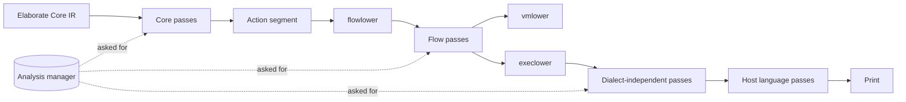
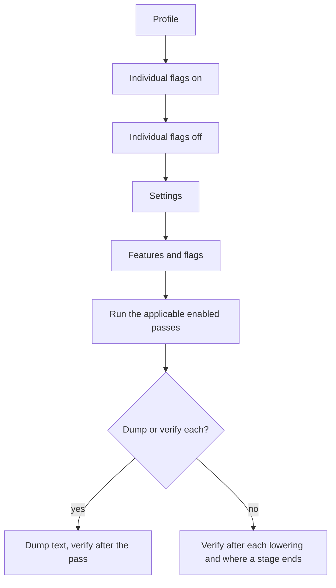

# The Pass Pipeline

> [!WARNING]
> This page describes the target architecture. The code may still differ from it.

The compiler rewrites a grammar on its way to every backend, and it checks the code that the rewrites produce. This page
explains how that work is organized: one pipeline of declared passes, lowerings among them, run by one manager, an
analysis manager that computes and caches what the passes need, a registry that gives each optimization a name, profiles
that choose values for the names, and verifiers and dumps. It is the one place where the pass model is explained. The
rewrites themselves, and why each one is safe, are in [Core IR and Code IR](intermediate-representations.md). The code
generation passes of host languages are in [Code Generation for Host Languages](host-code-generation.md). The decisions
are [record 063](records/063-configurable-optimization-pass-pipeline.md),
[record 072](records/072-release-package-layout.md) and [record 074](records/074-one-pass-pipeline.md), which decides
the interfaces of the pipeline, the manager and the text form.

## Why a Pipeline

Without a structure, every optimization is a function that the compiler calls at the right moment, and the right moment
is knowledge that lives in the calling code: this rewrite needs the first characters of each alternative, that one makes
those facts stale, a third is sound only when the parser reports no events. Three things then go wrong silently.

- A rewrite runs on facts that an earlier rewrite made stale, and the output is wrong or merely slower, and nothing says so.
- An optimization cannot be turned off on its own, so no one can measure what it is worth or bisect a bad output to it.
- A rewrite breaks an invariant of the intermediate representation, and the failure shows up in a printer, far from the cause.

The pipeline moves that knowledge out of the calling code and into declarations that a manager checks.

## Declared Passes

A pass is a value, not just a function. It declares:

- its **name**, which is the name of the dump that shows its result and of the error that names it when it fails. An
  **optional** pass has a flag of the same name, which turns it off. A **required** pass, such as a lowering, has a
  name and no flag: it runs whenever the pipeline reaches it, and no flag or profile turns it off;
- the passes it must **follow**, for passes that share no data and that an analysis would not order;
- when it **applies**: a set of features (limit controls, Documents, tracing and the like). Core IR has no mode, so a
  Core pass that applies to every build declares no feature. A pass that does not apply never runs, whatever its flag
  says;
- its **obligation**, one sentence that says what it preserves: for a rewrite, the input consumed, the expectations
  recorded and the values built stay the same;
- the **analyses it asks for**, and the analyses it **preserves**.

A pass is typed by the IR it takes and the IR it returns: it is a pass from one IR to another, which takes a unit of its
input IR and returns a unit of its output IR with the set of analyses it preserved. A transform keeps its IR; a lowering
returns another IR or another dialect. A compilation is one pipeline, assembled by the driver as a typed composition of
passes: a sequence of transforms on one IR, then a lowering to the next IR, and so on. Because each pass takes the type
its predecessor returns, the Go type checker ensures that every pass receives the IR that the previous pass produced.
The generic manager of the pass infrastructure runs the enabled passes in order, invalidates what each pass did not
preserve, and on request verifies and dumps after each pass. The pipeline holds every step of the compiler in order: the
transforms, the steps that analyses drive, and the lowerings.

The declarations are checked before anything runs: names are non-empty and distinct, every requested analysis has a
key, and every pass named in a follow list precedes the pass that names it. A declaration that cannot be satisfied is an
error of every run, before any pass runs.

## The Pass Model

Transforms run in an explicit list, in order; analyses are computed when they are requested and cached. The model is
generic over the input and output IR of a pass and has four parts.

- **Preserved sets.** A transform declares the set of analyses it keeps. A preserved set **preserves nothing by
  default**: a pass that forgets to declare what it keeps invalidates everything, which costs time but never gives a
  stale answer.
- **Analysis keys.** Each analysis has a key with a name and a run function. Registering a second key with the same name
  is rejected, so two analyses of the same name and different types cannot confuse the cache.
- **The analysis manager.** It computes an analysis when it is asked for, caches the result, and records which analyses
  each analysis used. Invalidating an analysis invalidates the analyses that used it, transitively. An analysis that
  depends on itself is detected and is an error. A failed analysis returns an error; it never degrades silently into a
  weaker answer.
- **The transform interface, the manager and the registry.** A transform declares the name, ordering, obligation and
  applicability of a pass, and runs on a unit, returning the new unit and its preserved set. The manager runs the enabled
  passes, invalidates the cache after each, and verifies and dumps on request. The registry holds the passes and their
  control flags.

A transform returns the unit after it, and a transform that changed nothing returns its input with every analysis
preserved. A transform may change the unit it is given in place; when a copy is needed is the manager's policy, and no
pass declares anything about copies. A **segment** is a maximal run of consecutive optional transforms of one unit; a
required step, a lowering or the boundary of a part of the pipeline ends it. The manager copies a unit once per segment,
before its first pass runs, when the segment's start must survive: when someone else keeps the unit (the caller's
input, a result shared between tables or backends, the input of several backends), or when a failure must roll back to
it. A pass that fails, or under `-verify-each` a result that does not verify, rolls its unit back to the start of its
segment and ends the optional passes of its unit; only the required steps go on, so a printer still gets a lowered unit
and the first error is reported. In a module of many functions a failure ends the passes of its function, the other
functions finish the segment, and the later segments run only their required steps. The run-time backends fail on the
first error and consume their units, so they take no copy. An observer that needs the unit before each pass
(`-verify-each`, `-print-changed`, unit hooks, `-opt-bisect-limit`) makes the manager also copy before every pass, so
that every unit it was given stays as its pass returned it; the rollback point stays the segment's, so the output does
not depend on what is observed. So a normal build pays one copy per segment, a consuming build none, and a run that is
being diagnosed one per pass. A dump is valid while it is printed, since a later step may change the unit in place.
The returned preserved set is the declaration of what the pass kept: the result inherits those analyses, and a lowering,
which returns another IR, invalidates the whole cache. A copy keeps every analysis, so an analysis whose result refers
to parts of the unit by identity (pointers) cannot be kept as it is: it keys them by an ID that copies keep (Core IR
nodes carry one), or it is computed again.

Passes run one at a time, in the order of the pipeline. A pass that works on one function reads only analyses of the
module that were computed before it runs, and never the body of another function, so what it does to a function depends
only on that function and on facts fixed beforehand.

A run is deterministic: the same input, settings, pipeline and observers give the same output, dumps, events, numbers
and statistics apart from time, whatever the number of processors, and a test generates the grammars of
`testdata/grammars` for Go and TypeScript in one compilation with `GOMAXPROCS` 1 and N and compares all of them. A run
that nobody observes allocates nothing per step beyond the context of the pass, whether the step runs on a module or
on each of its functions; the events, results, dumps and counter maps exist only for an observer that asks for them.

The attributes on Core nodes (nullability, first sets, effects) are not cached analyses. They are invariants of the IR,
stored on the nodes and checked by the verifier. What the manager caches is derived results that are not written into
the IR: rule facts, site numbers, the call graph, the cost view, lookahead sets, liveness and the control-flow views that
some Flow passes use. The optimization passes, the linter, the complexity classifier and the generators share them, so a
fact has one implementation.

## The Pipeline



The pipeline runs these parts in order. Each part is a sequence of passes; the order within a part is in its
declarations.

- **Core passes** rewrite meaning-preserving forms and compute the facts: guard sets, first sets, effects, rule
  policies, normalization, and turning a value-free repetition of a class into a scan. They are independent of the mode,
  and they are the only passes that work on Core IR.
- **The Action segment** lowers the action expressions of each table to the table's Action module and runs the Action
  passes on it; it is described below.
- **`flowlower`** lowers Core IR to Code IR at the Flow stage, in one uniform shape that the Flow passes then refine.
- **Flow passes** make the control-level decisions, listed below. Their applicability is where the features matter: a
  rewrite is sound for a parser only if the parser does not observe what the rewrite removes. A match form that skips
  recording input applies only when no Document is in effect, and a form that hides rule entries applies
  only when the parser is not traced.
- **`vmlower`**, for the VM, selects bytecode instructions from the Flow stage, and the pipeline ends there.
- **`execlower`**, for host code generation, converts the Flow stage to the Exec stage completely.
- **Dialect-independent passes** run on the Exec stage, in the `codepass` package. They are described in their own
  section below.
- **Host language passes** legalize and optimize the Exec stage for one host language before it is printed. They are
  described in [Code Generation for Host Languages](host-code-generation.md).

### Lowerings

A lowering is a pass whose result is in another dialect or another IR. It declares its input stage and its output stage,
preserves no analysis, and has a postcondition: the verifier of its output stage, which always runs right after the
lowering, so that an error names the lowering. After `execlower`, for example, no Flow operation remains, which verification at the Exec stage checks because a module at a stage declares only operations of the dialects legal at it. A
lowering that makes part of the invariants of its output by construction checks only the rest: Elaborate computes
the attributes of its Core module with `Analyze`, so its postcondition is the structural Core verifier, and the
attributes are compared where the Core passes end. A lowering is
a required pass: it has a name in the registry and the dumps can name it, but no flag or profile turns it off, because
the stages after it need its output. Making it a pass gives it the registry, the dumps and the verification that every
other step of the compiler has, and keeps the order of the whole compilation in one pipeline.

`execlower` works within Code IR, from the Flow stage to the Exec stage of the same module, so it is an ordinary pass of
Code IR that keeps its IR and converts the dialect. `flowlower`, from Core IR to Code IR, and `vmlower`, from Code IR at
the Flow stage to bytecode, change the type of the IR: in the typed composition they are the points where the type
changes.

Each IR has its own analysis manager. A lowering preserves nothing, so the passes after it start with a fresh analysis
manager for its output IR, and after `execlower` no analysis of the Flow stage survives into the Exec stage.

The registry, `-print-after`, `-print-before`, the dumps and verification work on every pass, and the flags on every
optional pass, whatever its types, through a description of the pass that does not depend on them: its name, whether it
is required, and how to dump and verify its output.

The lowerings are packages of their own, outside the IR packages and apart from the passes of each dialect. That
placement says where the code lives; in the pipeline, each lowering runs as a pass.

### Lowering the Action Expressions

The action expressions of a table (the actions of its rules and of the lines of its Operators Rules, its predicates
and the values of its bindings) are lowered once, by the Action segment that every target runs on each of its tables
before the plan:

- `actionlower`, a required lowering, makes the table's **Action module** from its Core IR: one function for each
  action site, in the order in which Core IR numbers the sites, each with the attributes of its site, and the
  compositions that the functions call. The functions are the
  [lowering of action expressions](../../spec/exec-ir/lowering.md#action-expressions), with the visits of loop elements
  counted when the table counts logical compute units.
- The Action passes run on the function of each site, in the slot `action-passes` for every target and the slot
  `action-target-passes` for those of the target: `text-dispatch` for the targets that print predicates, and on the
  typed table of a Go parser `field-compare` and the step `go-struct-call`. A Go target then runs `go-in-place`, which
  adds the function that evaluates a rule's action in place, and every target ends with `action-finish`, which names
  the locals in order and drops the facts that only the passes read.
- The join of the split sets the Action module of each table. The Flow and Exec operations that evaluate an action
  expression name its site by number, so no operation of Code IR holds an action expression of Core IR.

The printers of Go and TypeScript print the functions of the Action module. `vmlower` selects each function into an
action program, which the bytecode VM and the closures both run, so the run-time backends evaluate action expressions
with one selection and one executor. The dumps, the verification, the bisection limit and the pipeline text cover the
segment as every other part of the pipeline, and its functions are listed per site under the label of their table.

Every backend is compared with the reference evaluator of action expressions, which evaluates them from their
semantics without any lowering, so a mistake of the lowering or of an Action pass shows up as a difference from that
evaluator rather than as a difference between backends that share it. A test fills `action-passes` with a pass that
breaks the functions and checks that the comparison finds it.

### Planning the Functions of a Table

Before `flowlower` runs, a planning step in the middle end (the `flowplan` package) decides which functions each rule
table is made of and in which form. It is a required pass over the whole program, not over one table: reachability
starts from every entry point of the program, and the expectation table is numbered across the tables, so these facts
are the program's. It decides everything that a printer would otherwise decide before or while printing: the functions
of each table and their forms, the reachable rules and the route of each call, the expectation table and the frame
layouts. The printers of Go and TypeScript take their tables from this plan, and the bytecode VM plans the Node table it
runs from Flow IR the same way, so that every backend runs the same functions and their compute units can be compared
per input.

The Core IR of a Node or recognizer table and the options its functions are lowered with are built by the steps of the
pipeline that every backend shares: `elaborate` elaborates the program with or without the projected values of the
Node table, the Core passes run on it, and the configuration of the table sets the lowering options from what the
parser charges and records (logical compute units, observation, Documents, traced bodies). The VM
builds the Node table of a parse with logical compute units, keeping only the guards whose skip makes no call, under the
settings of the program, and runs the driver's Flow passes for a target of its own, the bytecode target of the Flow
passes, so its functions are those of a generated Go parser with logical compute units in the forms the VM runs. The
closure backend takes the same Core module, built under the same key, with the Action module of its table, and builds
its closures from them when a parse first needs them; a VM and a closure target in one compilation share it. A compilation of run-time targets only stops at its
first failure (`Stop`), so it consumes its units and takes no copy.
The bytecode target declares what the VM prints beyond the forms of every backend: none of the forms of the Flow passes.
The forms of typed rules do not apply to the Node table, guarded classes apply only to functions outside
Documents and traced parses, and the VM has no instruction that compares a literal in place, so it matches each literal as the lowering
wrote it. Each form counts what it replaces, so the VM's functions count what the Go parser's do.

The functions of a planned table are lowered into one module, in the order of the plan, by one run of `flowlower`; the
Flow passes, `execlower` and the Exec passes then run on that module, each pass on every function in turn before the
next pass (see [Bisecting Passes](#bisecting-passes)), and a backend finds the function of a use in the module by its
key. The VM runs the Flow part on the module of its Node table, and the Go and TypeScript generators run both parts on
the modules of their tables: the Node table and the recognizer, and for Go the typed table and the traced copies.
Within the module, functions are named apart: a value-free twin by its rule's name and `/value-free`, the skip and the
lines of an Operators Rule by its rule's name and `/skip` or `/line` and the index of the line, and the stream body by
its rule's name and `/stream`.

The plan leaves out of a table the rules that no entry point reaches, unless the build keeps them. The expectation
table still has a row for every rule of the Node and recognizer tables, numbered as a parser that prints every rule
numbers it, so the functions that the plan leaves out of these two tables form a part of their own, labeled with the table's name and
`Unreachable` (`rulesUnreachable`, `recRulesUnreachable`). The part runs the same steps as its table in the same run,
and its dumps carry its label; the join at the Exec stage numbers the expectation table from both parts in the order
of the whole table, and the printers see only the tables they print. So each function is lowered once.

The plan takes the reach of the program from the compilation when it gives one, and computes it from the Core IR of
the tables after their passes otherwise. If the code that a printer prints enters other rules than that reach, the
printer returns the reach of the printed code instead of the files, and the driver runs the pipeline again with it,
which must then agree; this is the fallback of planning, and it applies to every backend. Only the TypeScript printer
returns such a reach today; what the Go printer prints is what the plan reaches. Under a bisection limit the pipeline
runs once (see [Bisecting Passes](#bisecting-passes)).

The plan of a table is computed from the Core IR of the table after its Core passes, the rules of the table (value-free
twins included) as the plan reads them: their definitions, actions and run-time facts, and the rules that the backend
emits. The tests of which rules may run flat or framed are the plan's; a generator that decides a route of its own asks
them too, so every backend lowers the same rules. It holds:

- The functions of the table, in the order a backend lowers them: the body of each rule, then the skip and the lines
  of each Operators Rule, and last, in the Node table of a parser with streams, the body of the start rule that
  ParseStream runs, which lowers its `#stream` repetition as the one that delivers the elements. Each function is
  described by exactly what its lowering takes besides the table's Core IR and options: its form, its Core rule and
  name, and for a framed body the body, its capture slots and whether it builds a value. With the Core IR and options
  of the table, which every function of the table shares, it is the unit that `flowlower` lowers. A backend finds the
  function of a use (a rule body, an Operators Rule skip or line) by its key.
- The route of each rule body. A value-free, lean, plain rule whose body has no cut, recovery, predicate or nesting is
  a **flat** function, with no frame. Any other rule whose Core body can run inside the frame its runtime owns is a
  **framed** body, which builds its value unless the rule is lean. A flat function carries the framed body as its
  fallback. In the typed table, every rule that `flowlower` can lower as a local function is a flat function that
  returns the rule's typed value, with no fallback and no refusal; a left-recursion leader or a rule that recovers is a
  framed body that builds its value when its frame has the slots of the frame the typed runtime shares with the Node
  rule.
- The refusal of a flat function, an analysis of its Flow IR as `flowlower` writes it, before any pass: the function
  is refused when a reachable statement reads its entry position or its context, which a flat function has no
  parameters for, or when a variable holds a value, which a value-free function does not keep. Reachability is the
  printers' (the dead-store analysis of Code IR). The plan makes this decision once, for every backend, while the
  table is lowered: the lowering asks the plan about each flat function right after writing it, and a refused function
  is replaced in the module by its lowered fallback, or left out if the rule has none. The plan takes the decisions
  when the module is bound to it, so a lowering that fails leaves the plan as it was. No pass has run yet, so the
  decision reads no form of a target, and the table is lowered once. A pass that makes a form of a target keeps what
  the decision reads; the Go generator checks that the flat functions it prints in its own forms are not refused, and
  fails with an internal error otherwise.
- The capture-slot layout of each rule's frame: the names of the Core rule's scope, empty for a rule that runs flat or
  as an Operators Rule. A backend verifies the rows it emits against it: the Go generator the scopes of its rule
  table, and the VM the scope of each rule whose body it runs from Flow IR, whose framed body runs in that frame.

For TypeScript the plan gives every table only functions that the printer prints: a capture read from variables exists
only in a flat function, which the plan gives no predicate and no value, and TypeScript has none of the typed table,
the Go-only forms of the Flow passes or streaming, which make the primitives it does not print. The required analysis
step `ts-printable`, right before `print-ts`, checks this on the Exec-stage tables against the primitives and variable
types that the TypeScript backend declares, and fails with an internal error otherwise; the printer prints only what
it admitted.

## The Flow Passes

The Flow passes hold every control-level decision of the Flow stage. Each pass declares its obligation, the property it
preserves, and the analyses it needs and keeps. The table is in the order the pipeline runs them.

| Order | Pass | Obligation (what it preserves) | Main analyses |
|:--|:--|:--|:--|
| 1 | call-specialize | The result, memo records, expectations and events of a call stay the same; under observation the call is kept | Core facts (Plain, Memo, Leader), call graph |
| 2 | inline | The same nodes, values, memo entries and errors at the same positions | Call graph, size |
| 3 | dispatch (program) | Skipping a guarded alternative leaves the state that evaluating it leaves, and records the same expectations | Core guards, the calls a skip passes over, memo policy |
| 4 | match-form | The same input consumed, the same expectations recorded and the same compute units counted | Features (Document, Traced) |
| 5 | save-elide | No save that no failure path reads | Core effects, liveness |
| 6 | fail-merge/thread | The same behavior on every reachable path | Reachability |
| 7 | canonicalize | The same behavior; each pattern keeps the behavior of the operations it rewrites | None beyond the operations it matches |
| 8 | charge | None runs: a parse counts the logical events of [Compute Units](../../spec/runtime/parsing.md#compute-units), which fix where units are counted on every backend, and checks them where [Checks and Interruptions](../../spec/runtime/parsing.md#checks-and-interruptions) says | None |
| 9 | slots | Locals share a slot only when their types are equal and their live ranges do not overlap | Liveness |
| 10 | outline (program) | The same behavior | Structure and size of the Core nodes |

Dispatch and outline run before the Flow stage, on the tables of the program right before `plan`, so each table's
choice is made once, and the lowering of every part of a table reads it from the table's lowering options.

Dispatch chooses, from the Core IR of each table and its lowering options, the alternatives that keep the guard that
the Core pass `guards` gave them, and what the skip of each makes. Without logical units and Documents every guard is
kept. Otherwise a guard is kept when the calls that evaluating the alternative makes before its first terminal fails are
known; under logical units the skip makes the effects of these calls, and a Document parse evaluates an alternative
whose skip would pass over a call of a rule it memoizes. Both pipelines run it, on by default; `-no-opt dispatch`
lowers every alternative without its guard, and `-print-after dispatch` writes each table with its guarded alternatives
by path. The VM chooses the guards of its table the same way when it lowers it.

Outline chooses, from the Core IR of each Node and recognizer
table after the Core passes, the nodes that run as functions of their own: a large node, the large parts of one, and,
in a table that builds values, a structure that occurs more than once where it would not already be shared. The TypeScript pipeline runs it, on by default, since its runtime
wants small functions and its printer shares outlined functions whose text is equal; `-no-opt outline` lowers every
node in place. The Go pipeline does not run it.

Save-elide narrows each mark to the parts that a failure path reads. A mark that no failure path reads at all is a dead
store, and save-elide removes it through dead-store removal, so dead state has one mechanism.

Marks stay typed locals: a choice restores the same mark before each of its next alternatives, and a loop restores the
mark of its iteration. The verifier checks how marks nest: every use of a mark is dominated by the mark's definition in
the structured body, and the marks of one component are used last in, first out, so no mark is used after a restore to
an older mark of the same component. The preconditions of the operations that take marks, such as truncating the
recovered errors to a mark, resetting the record of missing input or ending the innermost isolation of expectations, are
checked by the verifier, not only stated in their contracts.

The Flow stage stays structured. A pass that needs a control-flow graph asks the analysis manager for a graph view, so
the form that is printed and verified is the structured one. The Flow verifier runs right after `flowlower`; then the
`PerFunc` segment of the Flow passes verifies each of its functions where it ends, before `flow-finish`, if an optional
pass ran on it; and with `-verify-each` after every Flow pass. Outside `-verify-each`, the required steps after that
segment, `flow-finish` among them, are not verified again. The verifier checks the structure, the variables, one runtime
per function, recorded reads under a Document, and that a traced parse does not read in place.

## Dialect-Independent Passes of Code IR

The dialect-independent passes are the passes of Code IR that every dialect can run, in the `codepass` package. They
specialize functions for the features of a build, canonicalize, remove dead stores and share identical helpers and
literal tables. They depend only on the reads and writes that each operation declares, so they work for every dialect.
They never see Core IR; the Core passes are the ones that work on Core IR. The host-language passes run after them, on
the Exec stage.

### Canonicalization

One pass of Code IR, `canonicalize`, applies local rewrite patterns until none applies. The dialect of each stage
declares which patterns apply at the stage, and the pass runs at both stages: at the Flow stage after fail-merge/thread, and at the Exec stage after specialization for
the features of a build and before dead-store removal, so that what specialization made unreachable is gone before
liveness is computed. A pattern rewrites one operation, or a few adjacent ones, into a simpler form: it folds a
constant, removes code after an exit or splices a block into its parent. Each pattern has a name in the registry, so
`-opt` and `-no-opt` turn it on or off, `-opt-bisect-limit` gives each of its applications a number of its own,
`-print-pipeline` lists it under the pass, and the statistics count its applications. The pass tries the patterns in a
fixed order, so it reaches the same fixed point and the same output on every run. Running the patterns together to a
fixed point lets one rewrite expose the next without another pass in the pipeline, and the names of the patterns keep
each rewrite measurable and bisectable by itself.

The patterns of the statements and expressions that every dialect shares are `fold-constants`, `fold-branches`,
`drop-after-exit`, `drop-unused-labels` and `splice-blocks`, tried in that order. The dialect of each stage declares
which of them it takes: the Exec stage takes all five, and the Flow stage
takes the first three, because every block of the Flow stage keeps a label of its own, so removing a label or splicing
a block would break its invariant. The dialects have no patterns of their own operations yet. Code IR makes every
pattern, so the pass declares them all without importing a dialect, which only the conversions do for more than one
stage; at each stage it applies those that the stage's dialect declares. The pass is one pass at both stages: it has
one name, one flag and one list of patterns, and the manager numbers its runs at the two stages as instances of one pass.
The specialization of a composition applies every pattern of the Exec stage to its copy itself, so a composition is the
same whatever a build turns off.

Rewrites that are not local patterns, such as specialization for the features of a build, dead-store removal and the
sharing of helpers, stay passes with names of their own.

### Specializing the Libraries

The runtime libraries are written once as compositions of the Exec dialect, and a library is a set of copies of them,
each specialized for some of the features: every feature expression of the copy becomes a constant. The unit of a
library, `library`, holds the compositions module, the requests of the library (the composition, the features, the
name of each copy and the file it is printed into, within which the name is unique), the copies, kept outside the
module, so that two requests of one composition under different features do not collide and the module never changes,
and the functions that later passes make of a copy, each tied to the request of its copy. The required pass `specialize` makes one copy per request, in
request order. A copy is a function of its composition and its features alone, so the pass reuses the copies of an
earlier compilation with the same module and requests, from a memo of the most recent ones that a bound keeps
small.

The TypeScript library of a parser is specialized for the parser's features inside the TypeScript pipeline: after the
tables are lowered, the required step `ts-library` requests the compositions that the library replaces for the features
that the used-features analysis of the plan finds, `within ts-library { specialize! }` makes the copies, and, after `ts-printable`, `print-ts`
prints them into the parser's library. The library alone (`-lib only`) has no grammar: its pipeline starts at the
library, with every feature requested, and runs `specialize` and `print-ts-lib`.

The Go library, the parse state of the engine and their conformance bindings are checked-in files that no grammar
determines either; `go generate` in the library printer's package writes them through the Go library's route:

```text
pipeline library -> output {
  specialize!
  go-cold-path!
  print-libgo!
}
```

Its source unit holds the compositions with the requests of every file that the library printer prints, grouped by
file. `go-cold-path` splits the cold path off each guard that generated code inlines into a function of its own, named by the request that asks for it, which
the unit keeps beside the copy of its request, and `print-libgo` prints the files as the output, with paths from the
root of the module. Its text has the headers `sxir`, `settings` and `debug` only, and the reader tells it from the
TypeScript library's text, which also starts at `library`, by its lack of a target. The route has no slot, so an edit
that names a slot of the parser pipelines fails before any step.

Instruction selection in `vmlower` is a table of local patterns
of the same kind: it is deterministic and counts the matches of each pattern.

## The Registry

An optimization is a **flag** with a name in one registry, the generic registry of the pass infrastructure. Each part of
the pipeline registers its own passes where the part is defined (name, description, default and applicability), and the
controls of printers and libraries are registered with the kind `library` by the code generators that own them. Each
name is declared in one place, and every name differs from the others, so one name selects one pass in the flags and in
the dumps. A flag has a kind, which says what it changes: a pass of the pipeline, a pattern of `canonicalize`, or a
library control (the runtime structures and helpers that the printers emit, such as allocating typed objects in slabs or
sparse memo tables).

A flag is on or off, or it has an integer parameter, where 0 turns it off. The registry checks itself: names and
descriptions exist and are unique, a value is 0 or 1 unless the flag takes a count, and a flag that **changes the output**
(the generated API or the representation of what a parser returns, not only its code and resource use) must be an opt-in
that no profile sets. That rule is the line between two contracts. An optimization that is not marked keeps the results,
the errors and the events of the parser, so it needs a test that the parser with the optimization off behaves the same
as the parser with it on. One that is marked has a contract test of its own, because turning it on is a decision about the
API.

The same names serve three uses: a user turns an optimization off to see what it is worth, a test compares a parser
against the same source with one flag changed, and a reference page names the flag that is the control of a measured
mechanism. A flag is how an optimization becomes something that can be measured by itself, which is why the catalog of
[measured mechanisms](../optimizations/README.md) names the optimization flag that is each mechanism's control.

## Profiles

A profile is only a preset: a name for fixed values of flags. A user chooses it through the public type `Optimize` of
`pkg/compiler`, whose profiles are `Speed`, `Memory` and `Size`, with overrides of flags. The option `WithOptimize`
gives the setting to a call, and the same setting applies to every backend: the closure backend, the VM and the
generators. The table from profile names to values is in the driver, which resolves the setting once and passes it to
the pipeline.

| Profile | For | Differs from the default by |
|:--|:--|:--|
| `speed` | the fastest parse that does not cost generated code or memory out of proportion; the default | nothing: the registry's own defaults are the speed values |
| `memory` | fewer bytes allocated and less live heap | typed objects and lists are not allocated in slabs |
| `size` | smaller generated source and binaries | literals are not compared in place; classes of five ranges or more match through a table |

A profile is kept only if it earns its place by a rule of measurement
([optimization 136](../optimizations/136-measured-effect-of-the-generation-flags.md)): it must improve the metric it is
named for by a margin beyond the noise of an identical copy on most of the language grammars, cost little parse time
overall and slow no grammar by much. That is why there are three profiles and not one per flag.

The settings of a generation are layered in a fixed order, so that each layer has one job: the profile sets the values,
then the individual flags turn on or set values, then the individual flags turn off. The later layer wins, so a profile
with one flag set differently is a valid setting, and a name that no flag has is an error that lists the valid names.

## Verification and Dumps

Each stage has a verifier: for Core IR, the checks listed in
[What the Verifier Guarantees](intermediate-representations.md#what-the-verifier-guarantees); for the Flow stage, the
structure, the variables, one runtime per function, recorded reads under a Document and no
in-place reads in a traced parse; for the Exec stage, among its checks, that no Flow operation remains. The verifier of
a lowering's output stage is its postcondition, and it always runs right after the lowering, so an error names the
lowering; a lowering narrows it to what it does not establish by construction, as Elaborate does. The other runs of
the verifiers are where the pipeline leaves a stage. That tells a user that a transform
broke something, and not which one, so a run can verify after **every** transform, with `-verify-each`: the error then
names the first pass that left the module invalid. Under `-verify-each` the pipeline also checks what each transform
claims to preserve: a pass that declares that it preserves every analysis must leave the text form of the unit
unchanged, and the pipeline reports a pass that changed it, because the analyses it kept would then be stale. Tests and
diagnosis ask for this; it costs compile time and changes no output.

A run can also **dump** the module as text after a step or after a pass. The `-print-after` flag of the gen command
takes the names of steps and passes, and `all` for every step and pass but `plan`, and prints to standard error. The
required steps are `elaborate`, `plan`, `flowlower`, `flow-finish` and `execlower`; each dump is named after the step that
produced it. `plan` dumps the plan of the program (the entry points, and the route and reach of each rule) only
when it is named, since it is not a form of the module that the passes change. A dump of
the Flow or Exec stage prints each function as a listing of Code IR. A pass that did not apply prints nothing, which is
itself information: the dump is the way to see why an optimization did not happen for a parser.

Every table runs a stage before the next stage of any table runs, so the driver keeps the dumps of each table
together: the dump of the plan first, then the dumps of each table, from its Core IR to the Exec stage, in the order
of the table's first dump. A dump's header names its table, so the dumps of one table read in the order of its steps.
A compilation of several targets runs them as the branches of one fork, each named by its backend (`go`, `ts`, and
`go#2` for a second Go target). Their dumps and statistics carry the branch's name before the table, as in
`-- after plan [ts/program] --` and `ts/plan`: the dumps of the programs of every target come first, in target order,
then those of each target's tables, and the dumps of one target are those it gives compiled alone. A target that
builds the same Core IR as an earlier one replays it instead of building it again.



## Controlling Passes

The passes are controlled by the optimization settings, which are the same for every backend, and by what is observed.
The gen command takes them as flags, and a Go program gives the same settings to the compiler package. The command builds the same settings that a
Go program gives, and the driver reads only those, so the command line and the Go API cannot drift apart.

### Choosing Optimizations

- `-optimize` chooses the profile: `speed`, `memory` or `size`.
- `-opt` takes a list of names separated by commas and is applied after the profile: a name alone turns on a flag that
  the profile leaves off, a name with `=0` turns it off, and a name with `=N` sets a flag that takes a count to N.
- `-no-opt` takes a list of names and turns them off after `-opt` is applied, to isolate a miscompilation or to measure
  one optimization.

These flags name the optional entries of the registry: the optional passes and the library controls. A required pass,
and every lowering is one, cannot be turned on or off: naming it in `-opt` or `-no-opt`, or in an override of the Go
setting, is an error. In Go, the setting is a value of `Optimize`, given with `WithOptimize`: a profile and the
overrides of individual flags.

### Observing the Pipeline

- `-print-after` takes step names, pass names and `all`, and dumps the module after each, as described above. A name
  selects every instance of its pass. The names of the stages (`core`, `flow`, `exec`) select nothing: the error names
  the step that makes the IR of the stage (`elaborate`, `flowlower`, `execlower`).
- `-print-before` takes pass names and `all`, and dumps the unit that each run of a named pass receives, as
  `-- before <pass> [<unit>] --`, before the dump after the run if `-print-after` selects the pass too. A required step
  is an error: its input is the dump after the step before it. A run that does not happen (the pass is off, does not
  apply or is skipped by bisection) dumps nothing; a run that fails dumps its input, which is what to look at.
- `-verify-each` runs the verifier after every transform, so that an error names the first pass that left the module
  invalid, and reports a pass that claims to preserve everything but changed the text form of the unit.
- `-print-changed` dumps the unit after each transform whose text form it changed, and nothing after a transform that
  left the text as it was, whatever the pass reported. Before the first such dump of a unit it dumps the unit as that
  transform received it, as `-- before <pass> [<unit>] --`, so the first change has something to compare against. A
  lowering makes a unit of another stage rather than changing one, so it is not dumped. A pass that `-print-after`
  selects too is dumped once.
- `-print-pipeline` prints, before the build, the pipeline that the driver assembled for it in the text form of
  [Textual Pipelines](#textual-pipelines): headers with every option of the build, then the steps in order in the blocks
  that run them, the required ones marked with `!` and the patterns of a pass, such as those of `canonicalize`, listed
  after it. It prints the first run; the fallback of planning, which gives a second run the reach of the printed code,
  is repeated by a build from the text.
- `-stats` prints, after the build, a `-- stats --` block: one line for each pass instance that ran, required steps
  included, in the order in which each first ran, with its counters summed over the units. The manager keeps three
  kinds for every pass: the units it ran on (`runs`), the runs that reported a change (`changed`), and the applied and
  skipped applications of each pattern, such as those of `canonicalize` and instruction selection. A pass adds the
  counters that it declares, such as what it rewrote, in the order of its declaration; counting an undeclared one is an
  error of the pass, as asking about an undeclared pattern is. The block is the same in every run of the same build.
  Tests pin the counters of a pass on a fixture through an observer of the driver rather than through the text, so
  that an optimization that stops firing is noticed. Every pass reports a change whenever it runs today, so `changed`
  equals `runs`, and only a declared counter shows that a pass stopped rewriting.
- `-time-passes` prints, after the build, a `-- time-passes --` block: the wall time of each pass instance and required
  step, summed over the units it ran on, in the order in which each first ran, with its share of the total; a `manager`
  line with the time the manager spent outside the steps (verification, copies, dumps and observers); and a `total`
  line with the time of the runs of the manager. The time of an analysis is charged to the pass that queried it.

When the fallback of planning runs the pipeline a second time, with the reach of the printed code (see
[Planning the Functions of a Table](#planning-the-functions-of-a-table)), only the run that writes the files is
observed: its dumps, statistics and times are the ones reported. The driver keeps them until that run ends and writes
the dumps also when it fails, since they show what led to the error, and drops what it kept of the first run when it
starts the second.

These settings do not change the parser that is built, bisection apart, so they are not part of `Optimize`. In Go they
are a value of `Debug`, given with `WithDebug`, whose fields mirror the flags one to one: the passes to print before
(`-print-before`) and after (`-print-after`), printing after a change (`-print-changed`), verification after each
transform (`-verify-each`), the statistics (`-stats`), the timing (`-time-passes`) and the bisection limit
(`-opt-bisect-limit`) and the pipeline text (`-print-pipeline`), eight fields. The writer the output goes to has no
flag: the command writes to standard error. The command builds its `Debug` value from its flags in one place, so a test
and the command line see the same pipeline and the same dumps.

The text these settings write is a debugging aid. Its form, the pass names and the counter names are not stable and may
change in any version; the flags and the fields are the interface.

### Bisecting Passes

`-opt-bisect-limit N` numbers the runs of optional passes in the order the pipeline makes them, runs those numbered up
to N and skips the later ones. A run is one pass on one unit, so a pass that runs per function counts once for each
function. The passes of a module of many functions, such as the module of a planned table, run pass by pass: the first
pass on each function in the order of the module, then the second, so the numbers, and the dumps after each pass, follow
the passes and, within a pass, the functions. A run of `canonicalize` on a unit takes one number like every pass, and
each application of one of its patterns takes a number of its own, so that skipping a number skips that one application.
Required passes always run, so the output stays a valid parser whatever N is. Each decision is reported with its number,
the name of the pass, the unit and whether the pass ran, as `opt-bisect: <number> run|skip <instance> [<unit>]`. The
numbers run on over every stage and table of a build. In Go, the limit is `OptBisectLimit` of `Debug`, a pointer that is
nil without a limit.

A generator that runs the pipeline more than once would number the runs of each pass differently in each, since the
first run lowers rules that the second leaves out. Under a limit it therefore generates once: the Go generator keeps
the rules that the printed code cannot reach, and the TypeScript generator does not generate
again without the rules that only its unprinted calls reach. The output of a bisection is a valid parser with the same
behavior unless a skipped pass is wrong, but its files are not those of a build without a limit. A differential test against the closure reference parser can then search for the smallest N at which the generated parser
differs from the reference, and that run names the pass, and the unit, that introduced the difference.

### Textual Pipelines

A pipeline prints as text with `-print-pipeline`, and for development a pipeline can also be given as a text. The text
carries every option of the build in its headers, so the driver can assemble the same pipeline again, and it may
reorder, repeat, insert or remove optional passes only. The driver checks it against the pipeline it assembles for the
same options before any pass runs: each pass takes the kind that the previous one returns, the ordering that the passes
declare holds, and the required passes, the blocks that hold them and the constant features are those of the assembled
pipeline. A text may also set a parameter of one pass instance, such as `pass(flag=3)`, which that instance reads in
place of the setting. Internal test support uses the textual form to test a pass in a chosen context; it belongs to
neither the public API nor the public command line.

The typed combinators and the text build the same step tree. How the combinators group the steps (`Then` over `Seq`, or
a body of one pass) means nothing, so a pipeline and its text verify at the same points and give the same run. Each
option of a build has exactly one header word, and a test holds the header scheme to the generation options, so a new
option cannot be left out of the text. The reader of the generation reads the headers into the options of the build,
assembles the pipeline for them and runs the text in its place; a build from the text writes the same files, dumps and
statistics as the build that printed it. A generation of several targets writes the call-wide headers once and one
`target` header per target, in the order of the targets; the reader gives each target the call-wide options and the
values of its own header.

The text of a run-time build, for the VM, the closures or both, has one more header, `program`, after `options`: the
role of the program (the parser of the grammar, or the recognizer or the missing-token insertion program derived from
it) and the options of the check of the grammar's parser that `options` does not write. Its settings are written as the
default profile with an override for each flag that differs. The driver cannot make such a program, so its reader is in
the compiler side of a run-time program (`internal/driver/checked`): it checks the grammar's parser with those options,
derives the program of the role as a parse does, and compiles the text, which gives the same bytecode and Core module.
The reader of a generation rejects a text with a `program` header, and a test holds the two headers together to the
options of the check.

A pass registered at several kinds, such as `canonicalize` at the Flow and the Exec stage, has one name in the text, and
the reader takes its registration at the kind of the place it stands. A feature whose value has no text form, such as
the target that the driver builds from the checked program, prints a label, and the reader takes its value from the
assembled pipeline at the same place, whose label must be the same. The fallback of planning gives the second run its
reach by replacing the constant `reach` of the pipeline that ran first, whether the driver assembled it or read it.
Over several targets it replaces that constant in the branches whose printers asked for a reach only, and runs the
whole fork again.

## Related Topics

- [Core IR and Code IR](intermediate-representations.md): the representations the passes work on and the rewrites.
- [Architecture](architecture.md): the overview and the driver flow.
- [Code Generation for Host Languages](host-code-generation.md): the host-language passes, the runtime library and the
  registry's library controls.
- [Record 063](records/063-configurable-optimization-pass-pipeline.md): the decision, the alternatives and the status.
- [Record 074](records/074-one-pass-pipeline.md): one pipeline per compilation, its interfaces and its text form.
- [Code Generation](../guide/code-generation.md#optimizations): the optimizations and the profiles, with their defaults.
- [Optimization catalog](../optimizations/README.md): the measured mechanisms and their controls.
