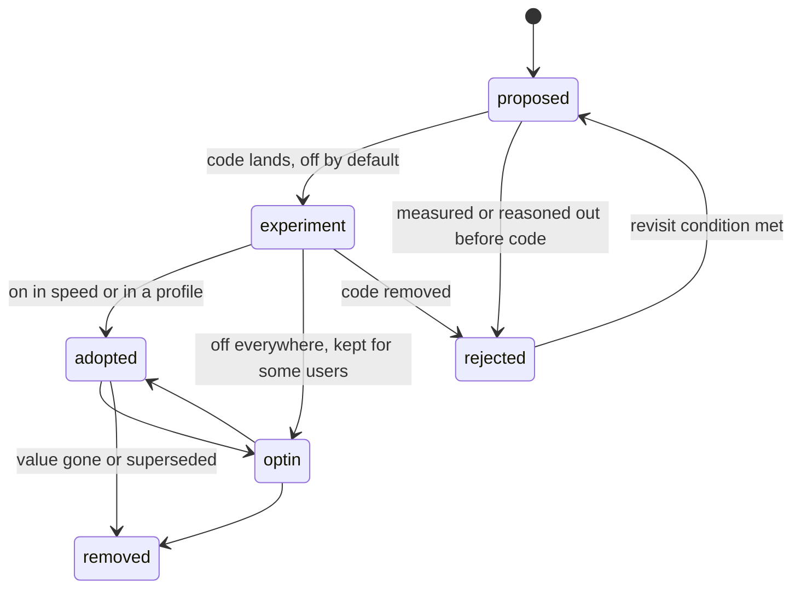

# 080. Optimization Management

- **Status**: Proposed
- **Author**: @ornew
- **Date**: 2026-11-26

## Summary

Every optimization of a SyntaxIR parser is a registered setting with a lifecycle, a record and a standing measurement.
The registry of optimizations in the compiler (record 063) becomes the single source of the optimization catalog: it
says, for each optimization, which catalog mechanism it implements, on which backends it acts, its lifecycle state,
the record that decided that state, and what it trades. The catalog's mechanism index, the flag table of the
code-generation guide and the table of rejected attempts are generated from the registry and the records, and tests
check that the generated files are current. Each mechanism of the catalog is classified either as an optimization,
which gets a setting and parity tests on every backend it acts on, or as an implementation design, which leaves the
catalog for the design pages. Every attempt to optimize ends in a record: adopted, opt-in or rejected, with the axes
it was measured on. `bench/metrics` measures the effect of every setting on the deterministic axes at each collection,
and timed measurement windows measure it in time, so that the value of each optimization is known as the code around
it changes. The bisection limit reaches every registered optimization.

## Motivation

The project has three pieces that this record joins.

- **The registry.** Record 063 made each optimization a named flag of one registry, `internal/pass`, with a kind, a
  one-line description, a speed default, whether it takes a count and whether it changes the output. Profiles are
  presets over the flags. Record 062 requires every optimization to be a pass with a stated precondition, a
  same-source switch and a negative-control test. 27 flags are registered today.
- **The catalog.** `docs/optimizations/README.md` indexes 89 mechanisms by stable ID (E, M, R, A, G), with their
  backend applicability, default state and same-source control. The index is written by hand. 58 of the 89 say
  "None maintained": they have no switch, so nothing shows that a parser without them returns the same results,
  nothing measures what they contribute today, and a regression inside one cannot be isolated by turning it off.
  Others are controlled by build tags (`sxir_reference_*`) or compile options, not by settings.
- **The evidence.** 138 numbered optimization records hold measurements. Their status lines use a free vocabulary
  (Implemented, Adopted, Measured, Removed, none). Rejected attempts live either in a record, in the hand-written
  table "Experiments That Did Not Pay Off", or nowhere but a deleted branch.

[Optimization Settings](../../../spec/runtime/optimization-settings.md) promises that no setting changes what a parser
returns. That promise can be checked only for an optimization that can be turned off. The performance milestone
needs to attribute each measured gain and regression to a mechanism (an A/B of one setting, `-opt-bisect-limit`).
Each optimization costs generated code, compile time, complexity and proof obligations, and its benefit changes as
other mechanisms land: an optimization measured once in 2026-10 says nothing about its value after the typed output
was rebuilt. And the knowledge of what failed, and when it is worth trying again, is lost when an attempt ends as a
deleted branch.

## Goals

- One source of truth for the catalog: the registry in code. The mechanism index, the guide's flag table and the table
  of rejected attempts are generated, and a test fails when a generated file differs from what generation writes.
- Every mechanism of the catalog is classified as an optimization or an implementation design, with the reason.
- Every optimization has a setting, and a parity test with it off (or, for an opt-in, on) on every backend that the
  registry says it acts on. A test checks the registry's backend claims against what the setting changes.
- Every optimization has a lifecycle state and a record that decided it. Every attempt ends in a record.
- The effect of every setting is re-measured continuously on the deterministic axes and in each measurement window in
  time, so its value is known at any commit.
- The bisection limit reaches every registered optimization: a limit of 0 builds the same parser as every
  optimization off.

## Non-Goals

- A fixed adoption threshold. Adoption weighs time, allocations, bytes allocated, retained memory, generated code size
  and compile time per case: an optimization may be slower and right for the `size` profile, or an opt-in that serves
  some users. The record states the axes measured, the profile values chosen and why. Record 136's rule remains the
  rule of the profiles it measured, not a rule for every decision.
- Settings for techniques inside the compiler, the linter or the language server that change no parser (see the
  classification criteria). Their speed is measured by the compiler metrics of `bench/metrics`.
- Changing the meaning of a setting: the contract of [Optimization Settings](../../../spec/runtime/optimization-settings.md)
  stays, except for the additions under "Public Behavior and Contracts".

## Design

### Entities

An **optimization** is a separable transformation or choice: the same compiler and runtime can build a correct parser
both with and without it, and the parser without it is a maintained implementation of the same contract that relies on
no other optimization being on. It is decided per compilation (a pass, a lowering option, a printer choice, a storage or
runtime structure the parser is built or generated with). An optimization has one or more flags and belongs to exactly
one mechanism of the catalog.

An **implementation design** is a representation or algorithm that the rest of the implementation is built on, whose
absence would be a different architecture, not a slower parser: the compact Node layout, per-position memo chains,
interned expectation IDs. It may also be a technique of the compiler or of the tools that changes no parser. It has no
setting. It is described in the design pages, with its invariants, and its measurements stay in the numbered records.

A **mechanism** is the catalog's unit: a stable ID (`M140`), a title, a page, and per backend whether it acts there
fully or on an eligible subset. Several flags may implement one mechanism (`guards`, `guarded-classes` and `dispatch`
all belong to first-character dispatch); a flag implements one mechanism.

A **profile** stays a preset of flag values with no logic of its own.

The classification criteria, applied to each of the 89 mechanisms in the appendix:

1. If the mechanism changes no parser (compiler, linter, language server, setup analyses), it is an implementation
   design of that tool.
2. Otherwise, if a parser without it would need a different representation or algorithm that other mechanisms or a
   contract depend on (the data layout every backend reads, the memo structure the complexity bounds rely on), it is an
   implementation design.
3. Otherwise it is an optimization: its off form is the plain form of the same construct (no guard, a general
   repetition instead of a scan, an unshared helper, a slab of one), and it gets a setting.

A mechanism that is split by the criteria (a representation that is a design, with a separable choice on top of it) is
split into a design section and an optimization with a narrower scope.

### Registry Metadata

The flag gains these fields; the existing ones (name, kind, description, count, speed default, changes output) stay.

| Field | Meaning | Checked by |
| --- | --- | --- |
| Mechanism | The catalog ID the flag implements | registration: the ID is declared |
| Status | `experiment`, `adopted` or `opt-in` | registration: an experiment and an opt-in are off in `speed` and in every profile; an adopted flag is on in `speed` or in at least one profile |
| Record | The optimization record that decided the status (for an experiment, the record that opened it) | test: the record exists and its status agrees |
| Trade-off | What it gains and what it costs, as the guide states it | generation |
| Backends | The backends whose parser the flag changes: closure, recursive VM, iterative VM, Go Node, Go recognizer, typed Go, TypeScript | test: turning the flag off changes the built or generated parser of a corpus case on exactly these backends |

A mechanism is declared once, in a table of the registry package next to the kinds: ID, title, page, path scope, and
per backend `full`, `partial` or nothing. `partial` means the mechanism acts on an eligible subset; the page says which.
A test checks that a mechanism acts on a backend if and only if one of its flags lists that backend, so the
applicability cells of the index are as true as the backend claims of the flags. Lifecycle states without code
(proposed, rejected, removed) are not in the registry: they live in records only.

### Lifecycle

- **Proposed**: an idea with a record (status Proposed) or an entry in the performance milestone's plan; no code.
- **Experiment**: code on main, off in every profile, with its parity tests. It exists so that the measurement and the
  parity tests run from main instead of a branch. It is listed with its status in the milestone plan.
- **Adopted**: on in `speed` or in at least one profile. The record names the axes measured and why each profile has
  the value it has.
- **Opt-in**: off in every profile, kept because it serves some users (a smaller parser, a different memory shape). The
  record names who and on which axis.
- **Rejected**: the code is removed or never written. The record keeps the numbers and a revisit condition: the change
  in the code or the workload that would make it worth measuring again.
- **Removed**: an adopted or opt-in optimization whose value is gone or that another mechanism supersedes. The record
  says why, with the standing measurement that showed it.

An attempt never ends as a deleted branch: it ends in a record in one of the final states, and the table of rejected
attempts in the catalog is generated from the records with status Rejected.

### Records

Optimization records keep the template of `docs/optimizations/000-template.md`, with these changes:

- The status is one of Proposed, Experiment, Adopted, Opt-in, Rejected, Removed, or Measurement (a record that
  measures and decides nothing, such as record 136). The existing records are migrated to this vocabulary: an
  Implemented record of a mechanism that is on by default becomes Adopted.
- A header line names the mechanisms and flags the record is about.
- **Axes measured**: one row per axis (time, allocations, bytes allocated, retained memory, generated code size,
  compile time), each with the workloads, the result or "not measured" and why.
- **Decision**: the state chosen, the profile values and why, and for Rejected the revisit condition.

The earlier rows of "Experiments That Did Not Pay Off" become short records with status Rejected, so that the table
has one source.

### Re-Measurement

The effect of an optimization is measured where its axis is reproducible.

- **Deterministic axes, at every collection.** `bench/metrics collect` gains a part `settings`. For each registered
  flag and each profile, it generates the grammars of `testdata/grammars` with the flag set against `speed` (off for a
  flag on in `speed`, its measured value for an opt-in or experiment), and records against the `speed` build: whether
  the generated parser is byte-identical, the size of `parser.go` and of the stripped binary, the compiler steps and
  allocations of the generation, and the allocations and bytes of the typed `ParseValue`, `Parse` and `Recognize` of
  the benchmark workloads, and the typed output retention. The keys are
  `setting <flag>=<value> <metric> <subject>` with policy `info`: a change of an effect is not a regression of the
  product, and `compare` lists it so that a landing that erases an optimization's effect shows it. A setting whose
  parser is byte-identical to `speed` on every grammar changes nothing on the corpus; the metric
  `setting-identical-grammars` makes that visible, and a flag at the count of grammars is a candidate for removal or
  for a corpus case. Units are not recorded per setting: equality of units is a parity test, not a measurement.
- **Time, in measurement windows.** The per-setting timing table is the `profilematrix` run (`bench/profilematrix`)
  over every flag and profile, with its A/A control, taken in an exclusive window by the timed measurement method of
  [docs/performance.md](../../performance.md). It runs at each performance milestone and before a release, and for any
  change that proposes a status change. Its results are published from `syntaxir/bench` with the other timed results,
  and the record that decides a status cites the run.
- **Review.** At each milestone the standing table is read against the statuses: an adopted flag that no longer moves
  any axis on any grammar, or an opt-in whose users' axis no longer improves, gets a record that keeps it with the new
  numbers or removes it.

### Bisection

`-opt-bisect-limit` numbers the runs of optional passes and the applications of their patterns, and skips those beyond
the limit. The printer and storage flags are read as plain settings and are not numbered, so a bisection cannot find a
miscompilation in them. The printers and the storage choices become decision points of the same manager: a printer
asks the manager before each decision a flag controls (each body it shares, each literal table, each left-out library
part), and a storage choice is one decision per compilation and backend. A test checks the invariant that makes the
bisection complete: for the corpus, a limit of 0 generates the same parser as every optimization off, and a limit
beyond the last decision generates the default parser.

### Checks

The checks extend the existing tests instead of adding parallel ones.

- **Registration** (`CheckFlags`): the metadata fields are present, the mechanism ID is declared, an experiment or an
  opt-in is off in `speed`. `CheckRegistry` of the driver adds the profile rules: an adopted flag is on somewhere, no
  profile sets an experiment or an opt-in.
- **Generation**: a program in `go generate` writes the mechanism index of the catalog, the guide's flag table and the
  table of rejected attempts; a test regenerates them in memory and fails on any difference. The hand-written
  `TestOptimizationsAreInTheGuide` becomes this test.
- **Catalog**: every mechanism has a page under `docs/optimizations/mechanisms/`, every page is a declared mechanism,
  and every record a flag names exists with a status that agrees.
- **Parity**: `TestOptimizationsHaveTests` also checks that each test it names exists. The generic parity tests turn
  each flag off on each backend the flag lists, over a shared corpus, and compare with the engine: trees, typed values,
  syntax and recovered errors, exact units and events. The flag-specific tests stay for the corpora that reach their
  edges.
- **Backend claims**: turning a flag off changes the parser of some corpus case on each backend the flag lists, and on
  no other.
- **Bisection**: limit 0 equals every optimization off; an unbounded limit equals the default.

### Public Behavior and Contracts

These changes reach the command line and the specification and need the owner's agreement:

- Experiment is a status of the public registry: an experiment's name is accepted by `-opt`, listed by `sxir gen -h`
  as experimental, and may be renamed or removed in any version. The specification's compatibility section says so.
- The kind list of the specification names `storage`, as the registry does; it names `runtime` today, which is stale.
- If runtime mechanisms of the engine and the Go library become settings (open question 2), the kind list gains the
  kind they use.

### Compatibility and Backend Support

The default parser of every backend is unchanged: the metadata, the generation and the checks change no generated
file except the docs they generate. New settings for mechanisms that are on today are on in `speed`, so the default
parser stays byte-identical; the tests that pin generated output show it. A setting that needs a branch on a hot path
of the runtime must show zero cost on the default path by the deterministic metrics (equal allocations and sizes) and
by a timed window before it lands.

### Implementation Sequence

1. This record.
2. Registry metadata, the mechanism table, generation of the index and the guide table, the generated-diff test, the
   catalog and test-existence checks. The flags that exist today get their metadata; the mechanisms that are not yet
   classified are declared with no flags and listed as unclassified until step 3.
3. The classification of the 89 mechanisms (the appendix), and the move of the implementation designs to the design
   pages, with every link updated.
4. Settings and parity tests for the optimizations without a setting, in the order of the performance milestone's
   gaps: `Recognize` against `json.Valid`, TypeScript against Go, typed CSV and left recursion, typed allocation
   growth, Document memory of Minilang, the DuckDB size profile; then the rest. Each is one commit series with its
   record entry.
5. The `settings` part of `bench/metrics`, the window procedure, and the contributor documentation in
   [docs/performance.md](../../performance.md).
6. The bisection decision points of the printers and storage choices, with the completeness test (may land with step 2
   if small).
7. Records for the recent attempts that have none.

## Alternatives Considered

- **A catalog file as the source, with code checked against it.** A YAML or Markdown table that the code is tested
  against keeps prose and data together, but the registry is what the compiler reads; two sources drift, and the
  owner fixed the registry as the source.
- **Mechanism fields on every flag instead of a mechanism table.** Simpler registration, but a mechanism with three
  flags repeats its title, page and applicability three times, and a test must check they agree.
- **Experiments only on branches.** Keeps experimental names out of the public command line, but the parity tests and
  the standing measurement would not run on them, and an abandoned branch is exactly the loss this record prevents.
  A name prefix (`x-…`) would mark experiments but force a rename on adoption.
- **Build tags as the control of runtime mechanisms.** Zero cost on the default path and already in place for several
  Document and stream mechanisms, but a build tag is not a setting: it cannot be bisected, it is not in the registry,
  and it selects for the whole program rather than for one parser.
- **A fixed adoption threshold for every optimization** (record 136's rule everywhere). Simple to apply, but it would
  reject size and memory trade-offs that some users need, and the owner decided adoption is per case.
- **Timing per setting on every collection.** Would make the standing table complete in one place, but time is not
  reproducible outside a measurement window.

## Testing

The generated-diff test, the registration and catalog checks, the backend-claims test, the parity tests per backend
and the bisection completeness test are described under "Checks". Each new setting lands with its disabled-form parity
test on every backend it lists and a negative control that shows the comparison notices a wrong parser, as the
existing route tests have.

## Limitations and Open Questions

1. **Experiments in the public registry.** Recommended: yes, as above, with the compatibility sentence. Alternatives:
   branch-only experiments (loses parity and measurement on main) or a name prefix (rename churn).
2. **Runtime mechanisms of the engine and the Go library** (memo, Document, stream and storage structures, such as
   chunked Document text or stream frame reuse). Recommended: a setting where the parser can choose the
   implementation when it is built (the engine) or generated (the embedded library leaves out the other form) at zero
   cost on the default path, shown by the deterministic metrics and a window; where no zero-cost switch exists, the
   mechanism keeps its build-tag reference control, the registry declares it as a reference control rather than a
   setting, and its record says why. Alternative: a setting everywhere, accepting a runtime branch on hot paths.
3. **Compiler and tool techniques** (constructor dependency analysis, copy-on-change attribute normalization,
   equal capture types, positional items, variable read components, LSP checkpoints, lint prefixes). Recommended:
   implementation designs of the compiler and the tools, measured by the compiler metrics; the setting contract
   covers parsers.
4. **IDs of implementation designs.** Recommended: the catalog keeps a short table that maps each such ID to its design
   page and the reason, so that records citing the ID still resolve and IDs are never reused.
5. **Cost of the `settings` part.** About 30 flags and 3 profiles over ten grammars is several hundred generations and
   builds; byte-identical generations are not built twice. If the part takes longer than the rest of `collect`, it
   becomes a part that `collect` runs only when asked, and the measurement windows always run it.
6. **Removal after the release.** Removing a flag is a breaking change of the command line. Before the first release
   it is routine; after it, a removed optimization's name may need to be accepted and ignored for a version.

## Appendix: Classification

To be filled in by step 3: one row per mechanism with the class, the reason, and for an optimization its flags; for
an implementation design the design page it moves to.
