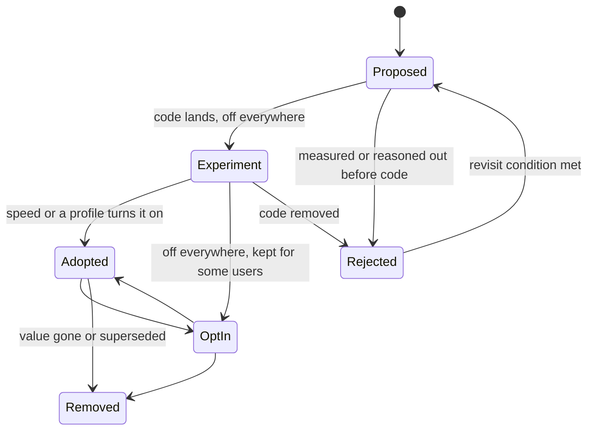

# 080. Optimization Management

- **Status**: Accepted
- **Author**: @ornew
- **Date**: 2026-11-26

## Summary

Every optimization of a SyntaxIR parser is a registered control with a lifecycle, a record and a standing measurement.
The registry of optimizations in the compiler (record 063) becomes the single source of the optimization catalog: it
says, for each optimization, which catalog mechanism it implements, on which backends it acts, whether it is an
experiment, the record that decided its state, and what it trades. The catalog's mechanism index, the flag table of
the code-generation guide, the map of retired mechanism IDs and the table of rejected attempts are generated from the
registry, the design pages and the records, and a test fails when a generated file is not current. Each mechanism of
the catalog is classified either as an optimization, which gets a setting (or, where no zero-cost switch exists, a
registered reference control) and parity tests on every backend it acts on, or as an implementation design, which
leaves the catalog for the design pages. Every attempt to optimize ends in a record. `bench/metrics` measures the
effect of every setting on the deterministic axes, and timed measurement windows measure it in time, so the value of
each optimization is known as the code around it changes. The bisection limit reaches every setting; reference
controls, which are build tags, are compared by builds instead. The first release
requires every mechanism to be classified and every optimization to have a control with parity tests.

## Motivation

The project has three pieces that this record joins.

- **The registry.** Record 063 made each optimization a named flag of one registry, `internal/pass`, with a kind, a
  one-line description, a speed default, whether it takes a count and whether it changes the output. Profiles are
  presets over the flags. Record 062 requires every optimization to be a pass with a stated precondition, a
  same-source switch and a negative-control test. 27 flags are registered today.
- **The catalog.** `docs/optimizations/README.md` indexes 89 mechanisms by stable ID (E, M, R, A, G), with their
  backend applicability, default state and same-source control. The index is written by hand. 58 of the 89 say
  "None maintained", one of them with a switch that only its tests use: nothing shows that a parser without them
  returns the same results, nothing measures what they contribute today, and a regression inside one cannot be
  isolated by turning it off. Others are controlled by build tags (`sxir_reference_*`) or compile options, not by
  settings.
- **The evidence.** 138 numbered optimization records hold measurements. Their status lines use a free vocabulary
  (Implemented, Adopted, Measured, Removed, none). Rejected attempts live either in a record, in the hand-written
  table "Experiments That Did Not Pay Off", or nowhere but a deleted branch.

[Optimization Settings](../../../spec/runtime/optimization-settings.md) promises that no setting changes what a parser
returns. That promise can be checked only for an optimization that can be turned off. The performance milestone
needs to attribute each measured gain and regression to a mechanism (an A/B of one setting, `-opt-bisect-limit`).
Each optimization costs generated code, compile time, complexity and proof obligations, and its benefit changes as
other mechanisms land: an optimization measured once says nothing about its value after the code around it was
rebuilt. And the knowledge of what failed, and when it is worth trying again, is lost when an attempt ends as a
deleted branch.

## Goals

- One source of truth for the catalog: the registry in code. The generated files are checked by a generated-diff test.
- Every mechanism of the catalog is classified as an optimization or an implementation design, with the reason.
- Every optimization has a control, and parity tests with it off (or, for an opt-in, on) on every backend that the
  registry says it acts on. A test checks the registry's backend claims against what the control changes.
- Every optimization has a lifecycle state and a record that decided it. Every attempt ends in a record.
- The effect of every setting is re-measured on the deterministic axes at each collection and in time in each
  measurement window, and a stale measurement is visible.
- The bisection limit reaches every setting: a limit of 0 builds the same parser as every setting off. Reference
  controls are outside it.
- **Release criterion**: no mechanism is unclassified, and every optimization mechanism has at least one control with
  its parity tests. A check enforces it (see "Checks").

## Non-Goals

- A fixed adoption threshold. Adoption weighs time, allocations, bytes allocated, retained memory, generated code size
  and compile time per case: an optimization may be slower and right for the `size` profile, or an opt-in that serves
  some users. The record states the axes measured, the objective it serves and why. Record 136's rule remains the
  rule of the profiles it measured, not a rule for every decision.
- Settings for techniques inside the compiler, the linter or the language server that change no parser (see
  "Compiler and Tool Techniques"). Their speed is measured by the compiler metrics of `bench/metrics`.
- Changing the meaning of a setting: the contract of
  [Optimization Settings](../../../spec/runtime/optimization-settings.md) stays, except for the additions under
  "Public Behavior and Contracts".

## Design

### Entities

An **optimization** is a separable transformation or choice: the same compiler and runtime can build a correct parser
both with and without it, and the parser without it is a maintained implementation of the same contract that relies on
no other optimization being on. It is decided per compilation (a pass, a lowering option, a printer choice, a storage or
runtime structure the parser is built or generated with). An optimization has one or more controls and belongs to
exactly one mechanism of the catalog.

An **implementation design** is a representation or algorithm that the rest of the implementation is built on, whose
absence would be a different architecture, not a slower parser: the compact Node layout, per-position memo chains,
interned expectation IDs. It may also be a technique of the compiler or of the tools that changes no parser. It has no
control. It is described in the design pages, with its invariants, and its measurements stay in the numbered records.

A **mechanism** is the catalog's unit: a stable ID (`M140`), a title, a page, and per backend whether it acts there
fully or on an eligible subset. Several flags may implement one mechanism (`guards`, `guarded-classes` and `dispatch`
all belong to first-character dispatch); a flag implements one mechanism.

A **control** turns an optimization off (or an opt-in on) for a comparison: a **setting** (a registered flag, part of
the command line and of `compiler.Optimize`) or a **reference control** (a registered build tag, for the cases under
"Runtime Mechanisms").

A **profile** stays a preset of flag values with no logic of its own.

The classification criteria, applied to each of the 89 mechanisms in the appendix:

1. If the mechanism is a technique of the compiler, the linter or the language server, it is an implementation design
   of that tool only if the generated output of every corpus grammar is byte-identical with and without it (checked
   once, on the branch that classifies it, with a temporary switch). If the output differs, it is an optimization.
2. Otherwise, if a parser without it would need a different representation or algorithm that other mechanisms or a
   contract depend on (the data layout every backend reads, the memo structure the complexity bounds rely on), it is an
   implementation design.
3. Otherwise it is an optimization: its off form is the plain form of the same construct (no guard, a general
   repetition instead of a scan, an unshared helper, a slab of one).

A mechanism that is split by the criteria (a representation that is a design, with a separable choice on top of it) is
split into a design section and an optimization with a narrower scope.

### Registry Metadata

The flag gains these fields; the existing ones (name, kind, description, count, speed default, changes output) stay.
Each fact has one source: the description says what the flag does (the usage text shows it), the trade-off says what
it costs and gains, and the guide's row shows both.

| Field | Meaning | Checked by |
| --- | --- | --- |
| Mechanism | The catalog ID the flag implements | registration: the ID is a declared optimization mechanism |
| Experiment | Whether the flag is an experiment | registration: an experiment is off in `speed` and set by no profile |
| Record | The optimization record that decided the flag's state (for an experiment, the record that opened it) | test: the record exists and its status agrees with the derived state |
| Trade-off | What it costs and what it gains | generation |
| Backends | The backends whose parser the flag changes: closure, recursive VM, iterative VM, Go Node, Go recognizer, typed Go, TypeScript | the backend-claims test |
| Witnesses | Per listed backend, the corpus cases on which the flag changes that backend's parser (one case may serve several backends) | the backend-claims test |

The run of the timed measurement that last covered each flag is not in the code: a data file beside the records,
`docs/optimizations/measured.json`, maps each flag name to its run, and the generator joins it into the index. A
measurement window updates that file only, with no code change; a test checks that its keys are registered flags.

The state of a flag that is not an experiment is derived, not stored: **adopted** if `speed` or a profile turns it on,
**opt-in** otherwise. The generated tables show all three states.

The registry also holds:

- **Mechanisms**: the optimization mechanisms only, declared once in a table of the registry package: ID, title, page,
  path scope, per backend `full`, `partial` or nothing (`partial` means an eligible subset that the page names), and a
  **Control** field: `flag` (it has at least one setting), `reference` (it has a reference control only) or `none`
  (a transitional state until its setting lands; the release criterion forbids it). A mechanism acts on a backend if
  and only if one of its controls lists that backend.
- **Reference controls**: the mechanism, the build tag, the backends, the witnesses and the record that says why no
  zero-cost setting exists.
- **Removed names**: each removed optimization's name with the record that removed it (see "Public Behavior and
  Contracts").
- **Unclassified mechanisms**: the IDs not yet classified, a transitional list that the release criterion empties.

Lifecycle states without code (proposed, rejected, removed) are not flags: they live in records, and a removed flag
leaves only its name in the list of removed names.

### Profile Objectives

Each profile serves one objective and declares the trade-off it accepts. A decision on an optimization says which
objective it serves; there is no threshold.

| Profile | Primary axis | Accepted trade-off |
| --- | --- | --- |
| `speed` | Parse time | Generated code, compile time and memory, as long as none grows out of proportion |
| `memory` | Bytes allocated and retained memory | More allocations and a little parse time |
| `size` | Generated source and binary size | A little parse time |

### Lifecycle

The state named OptIn in the diagram is Opt-in below and in the records.

- **Proposed**: an idea with a record (status Proposed) or an entry in the performance milestone's plan; no code.
- **Experiment**: code on main, off in every profile, with its parity tests. It exists so that the measurement and the
  parity tests run from main instead of a branch. It is listed with its status in the milestone plan.
- **Adopted**: `speed` or a profile turns it on. The record names the axes measured, the objective it serves, and why
  each profile has the value it has.
- **Opt-in**: off in every profile, kept because it serves some users (a smaller parser, a different memory shape). The
  record names who and on which axis.
- **Rejected**: the code is removed or never written. The record keeps the numbers and a revisit condition: the change
  in the code or the workload that would make it worth measuring again.
- **Removed**: an adopted or opt-in optimization whose value is gone or that another mechanism supersedes. The record
  says why, with the standing measurement that showed it.

An attempt never ends as a deleted branch: it ends in a record in one of the final states.

### Records

Optimization records keep the template of `docs/optimizations/000-template.md`, with these changes:

- The status is one of Proposed, Experiment, Adopted, Opt-in, Rejected, Removed, or Measurement (a record that
  measures and decides nothing, such as record 136).
- Header lines name the mechanisms (`none` for an attempt that belongs to no mechanism, such as a rejected idea) and
  the flags the record is about, and, for Rejected, `Revisit when`.
- **Axes measured**: one row per axis (time, allocations, bytes allocated, retained memory, generated code size,
  compile time), each with the workloads, the result or "not measured" and why.
- **Decision**: the state chosen, the objective it serves, the profile values and why, and for Rejected the revisit
  condition.

The table of rejected attempts is generated from the records with status Rejected, with their result and their
revisit condition as columns. The earlier rows of "Experiments That Did Not Pay Off" become short records with status
Rejected. The migration of the existing records to this vocabulary is a scripted rewrite of their headers, checked by
the test that the status of the record a flag names agrees with the flag's derived state.

### Re-Measurement

The effect of an optimization is measured where its axis is reproducible.

- **Deterministic axes.** `bench/metrics collect` gains a part `settings`. For each registered flag and each profile,
  it generates the grammars of `testdata/grammars` with the flag set against `speed` (off for a flag on in `speed`, its
  measured value for an opt-in or experiment), and records against the `speed` build: whether the generated parser is
  byte-identical, the size of `parser.go` and of the stripped binary, the compiler steps and allocations of the
  generation, the allocations and bytes of the typed `ParseValue`, `Parse` and `Recognize` of the benchmark workloads,
  and the typed output retention. The keys are `setting <flag>=<value> <metric> <subject>` with policy `info`: a change
  of an effect is not a regression of the product, and `compare` lists it so that a landing that erases an
  optimization's effect shows it. `setting-identical-grammars` counts the grammars on which the setting changes
  nothing; a flag at the count of grammars is a candidate for removal or for a corpus case. Units are not recorded
  per setting: their equality is a parity test, not a measurement.
- **Time, in measurement windows.** The per-setting timing table is the `profilematrix` run (`bench/profilematrix`)
  over every flag and profile, with its A/A control, taken in an exclusive window by the timed measurement method of
  [docs/performance.md](../../performance.md). It runs at each performance milestone, before a release, and for any
  change that proposes a state change. Its results are published from `syntaxir/bench` with the other timed results,
  and `measured.json` names the run for each flag it covered. A state change justified by time follows the A/A rules of the timed
  method; where the timing does not separate from the control, the decision rests on the deterministic axes.
- **Ownership.** A landing whose `compare` shows that it changes a setting's effect updates that flag's record (or
  adds one) in the same landing. The milestone review belongs to the project's maintainer: the standing table is read
  against the states, an adopted flag that no longer moves any axis or an opt-in whose users' axis no longer improves
  gets a record that keeps it with the new numbers or removes it, and each reference control is reviewed for whether a
  zero-cost setting has become possible.
- **Staleness.** The generated index shows each flag's last run from `measured.json`. A listing, run at the milestone review and not a
  failing test, names the adopted and opt-in flags whose run is older than the current milestone.

### Bisection

`-opt-bisect-limit` numbers the runs of optional passes and the applications of their patterns (`Ctx.Allow`), and skips
those beyond the limit. The printer and storage flags are parameters of the required printing step (the step declares
them and reads them as values), which the bisection neither numbers nor skips, so a bisection cannot find a
miscompilation in them. They become decision points of the same manager:

- A printer asks the manager before each decision a flag controls: each body it shares, each literal table it shares,
  each library part it leaves out. A storage choice, and a runtime setting of the engine chosen when the parser is
  built, is one decision per compilation and backend.
- A flag with a count is decided per site where its count applies: for `inline-literals`, each literal that the count
  admits for comparison in place is one decision, and a skipped decision compares that literal as the count 0 would.
  For `class-tables`, each class with at least the count of ranges is one decision, and a skipped decision matches
  that class by its ranges as the count 0 would. The count itself is not bisected; a limit narrows which sites get it.
- Reference controls are build tags, fixed for the whole program, and are not bisected.
- Decisions are numbered in the order of the pipeline and, within a step, in the order the step visits its input,
  which is deterministic because generation is (the determinism metric of `bench/metrics` checks it).

Tests check the invariants that make the bisection usable: a limit of 0 generates the same parser as every
optimization off, a limit beyond the last decision generates the default parser, and the same limit twice gives the
same parser and the same decision log.

### Runtime Mechanisms

A mechanism of the engine, of the Go library or of the TypeScript library (memo, Document, stream and storage
structures, such as chunked Document text or the reuse of stream frames) is a setting when its implementation can be
chosen when the parser is built (the engine) or generated (the embedded library leaves out the other form), at zero cost
on the default path: the deterministic metrics show equal allocations and sizes, and a timed window shows no slowdown.
A setting never adds a test at run time; the zero-cost check applies to the selection at build or generation time.
Where no such switch exists, the mechanism
keeps its build tag as a reference control, registered with its record. The generated catalog lists every reference
control with its record and reason, and the milestone review revisits it. A reference control has the parity tests of
a setting, run as two invocations, one with the default tags and one with its tag, whose printed configurations and
parse results are compared across them; it is not bisected and is not part of the command line. A mechanism that gains a setting
may keep its build tag as an additional control for tests.

### Compiler and Tool Techniques

Techniques of the compiler, the linter and the language server (constructor dependency analysis, copy-on-change
attribute normalization, reuse of equal capture types, positional items of action-free rules, variable read
components, LSP position checkpoints, bounded lint prefixes) are implementation designs of those tools once the check
of classification criterion 1 shows byte-identical generated output. The setting contract covers parsers; their speed
is measured by the compiler metrics of `bench/metrics`.

### Mechanism IDs

IDs are never renumbered or reused. A design page that describes a former mechanism carries its ID in a marker that
the generator reads, and the generator writes the map of these IDs to their design pages, with the reason, into the
catalog, under the same generated-diff test. A test fails for an ID that is both a mechanism and a design, or that no
page carries.

### Checks

The checks extend the existing tests instead of adding parallel ones.

- **Registration** (`CheckFlags`): the metadata is present, the mechanism is a declared optimization mechanism, an
  experiment is off in `speed`. `CheckRegistry` of the driver adds the profile rules: no profile sets an experiment.
- **Generation**: a program in `go generate` writes the mechanism index (with the Go Node and Go recognizer columns
  apart), the guide's flag table, the map of former IDs, the list of reference controls and the table of rejected
  attempts; a test regenerates them in memory and fails on any difference. The hand-written
  `TestOptimizationsAreInTheGuide` becomes part of it. The index states the counts of unclassified mechanisms and of
  mechanisms with Control `none`.
- **Catalog**: every mechanism has a page under `docs/optimizations/mechanisms/`, every page is a declared mechanism,
  and every record a flag names exists with a status that agrees.
- **Parity.** `TestOptimizationsHaveTests` also checks that each test it names exists. The observable of a backend is
  what it builds: the generated source for the generated backends (Go Node, Go recognizer, typed Go, TypeScript), the
  printed Core IR that the closure engine builds from, and the marshalled bytecode for the recursive and iterative
  VMs; for a runtime setting of the engine, the printed form of the built parser's configuration, which names the
  implementation it chose. A parity test turns the control off on a backend, checks that the observable differs, and compares the parser
  with the engine's default parser: trees, typed values, syntax and recovered errors, exact units and events. The
  default tier runs each flag's witnesses on the backends they are listed for, within its time budget; the long tier runs the
  full matrix of flags, backends and corpus cases. The flag-specific tests stay for the corpora that reach their edges.
- **Backend claims**: with a flag off, the observable differs from the default on every listed backend for that
  backend's witnesses, and is identical on every unlisted backend over the corpus (the second half in the long tier).
- **Bisection**: the three invariants above.
- **Release**: a test behind the build tag `sxir_release`, named like the other test tags (`sxir_long`), fails while any mechanism is unclassified or has Control `none`; the
  release checklist runs it.

### Public Behavior and Contracts

- **Experiments are public names with no compatibility promise.** An experiment is in the main registry: `-opt`
  accepts its name, `sxir gen -h` lists it as experimental, and it may be renamed or removed in any version. The
  compatibility section of [Optimization Settings](../../../spec/runtime/optimization-settings.md) says so. Keeping
  experiments on main is what lets their parity tests and the standing measurement run.
- **Removed names.** Before the first release, `-opt` and `-no-opt` reject a removed name with an error that names the
  record that removed it. After the release, they accept a removed name for one version with a warning that names the
  record, and ignore it, then reject it. Ignoring it is safe because no setting changes what a parser returns. An
  experiment's name needs no such period.
- **Kinds.** The kind list of the specification names `storage`, as the registry does; it names `runtime` today,
  which is stale.

### Compatibility and Backend Support

The default parser of every backend is unchanged: the metadata, the generation and the checks change no generated
file except the docs they generate. New settings for mechanisms that are on today are on in `speed`, so the default
parser stays byte-identical; the tests that pin generated output show it. A setting selects its form at build or
generation time and adds no test at run time; before it lands, the deterministic metrics (equal allocations and sizes)
and a timed window show that the default path costs nothing more.

### Implementation Sequence

1. This record.
2. Registry metadata, the mechanism table with its Control field, the reference controls, the removed names, generation
   of the index, the guide table, the map of former IDs and the rejected table, the generated-diff test, the catalog
   and test-existence checks, and the scripted migration of the record headers. The flags that exist today get their
   metadata; the mechanisms not yet classified are listed as unclassified.
3. The bisection decision points of the printers and storage choices, with the three bisection tests, so that every
   setting added later is bisectable from the start.
4. The classification of the 89 mechanisms (the appendix), and the move of the implementation designs to the design
   pages, with every link updated.
5. Settings and parity tests for the optimizations without a control, in the order of the performance milestone's
   gaps: `Recognize` against `json.Valid`, TypeScript against Go, typed CSV and left recursion, typed allocation
   growth, Document memory of Minilang, the DuckDB size profile; then the rest. Each is one commit series with its
   record.
6. The `settings` part of `bench/metrics`, the window procedure, the staleness listing, and the contributor
   documentation in [docs/performance.md](../../performance.md).
7. Records for the recent attempts that have none.

## Alternatives Considered

- **A catalog file as the source, with code checked against it.** A YAML or Markdown table keeps prose and data
  together, but the registry is what the compiler reads, and two sources drift.
- **Mechanism fields on every flag instead of a mechanism table.** Simpler registration, but a mechanism with three
  flags repeats its title, page and applicability three times, and a test must check they agree.
- **A stored state for every flag.** Simpler to read, but adopted and opt-in follow from the profiles, and a stored
  copy could disagree with them.
- **Experiments only on branches.** Keeps experimental names out of the public command line, but the parity tests and
  the standing measurement would not run on them, and an abandoned branch is exactly the loss this record prevents.
  A name prefix (`x-…`) would mark experiments but force a rename on adoption.
- **Build tags as the control of every runtime mechanism.** Zero cost on the default path and already in place for
  several Document and stream mechanisms, but a build tag is not a setting: it cannot be bisected and it selects for the
  whole program rather than for one parser.
- **A setting for every runtime mechanism, accepting a test at run time on hot paths.** Uniform, but it would make the
  default path pay for the ability to turn a mechanism off.
- **A hand-written table of former IDs.** Simple, but it would be a second source beside the design pages that
  describe them.
- **A fixed adoption threshold for every optimization** (record 136's rule everywhere). Simple to apply, but it would
  reject size and memory trade-offs that some users need.
- **Timing per setting on every collection.** Would make the standing table complete in one place, but time is not
  reproducible outside a measurement window.

## Testing

The generated-diff test, the registration and catalog checks, the parity tests per backend, the backend-claims test,
the bisection tests and the release test are described under "Checks". Each new control lands with its parity tests on
every backend it lists and a negative control that shows the comparison notices a wrong parser, as the existing route
tests have.

## Limitations and Open Questions

- **Cost of the `settings` part.** About 27 flags and 3 profiles over ten grammars is several hundred generations and
  builds; byte-identical generations are not built twice. Its cost is measured when the part is built: if it is small
  beside the rest of `collect`, every collection runs it; otherwise `collect` runs it only when asked, and every
  measurement window runs it.

## Appendix: Classification

To be filled in by step 4: one row per mechanism with the class, the reason, and for an optimization its controls; for
an implementation design the design page it moves to.
