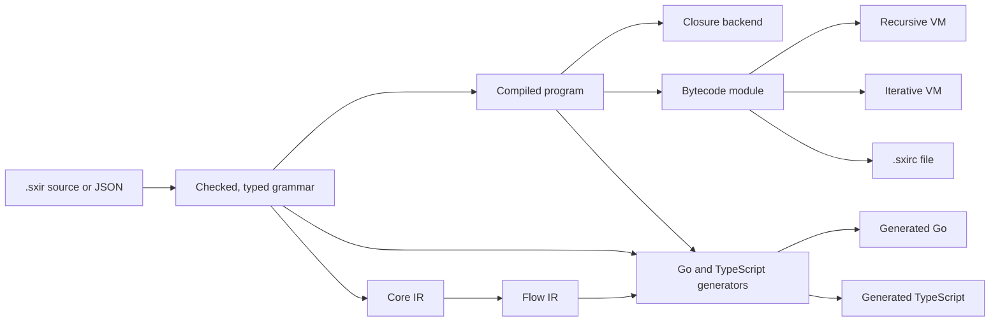

# Why SyntaxIR

SyntaxIR is a grammar compiler and parsing platform designed for every target, engine and use. You write one grammar. Today
SyntaxIR checks and compiles it once, generates Go and TypeScript parsers from it, and runs it on three engine backends in
Go. It aims to do the same for any target language, engine and optimization profile, and for every use (batch trees,
typed values, incremental documents, streaming, recognition and, as a goal, editors), under one contract and with the
best measured speed in each, against the fastest tools for each platform. The breadth is in targets and uses, not in
grammar class: grammars are PEG-based, with ordered choice.

SyntaxIR is pre-release, and much of that aim is still ahead. Each part is paired with where it stands today:

| Aim | Today | Goal |
|:--|:--|:--|
| One compilation path | The Core IR and Flow IR feed the Go and TypeScript generators; the engine backends compile the grammar by their own routes | Every backend on the Core IR ([design record 062](design/records/062-backend-independent-optimization-ir.md), partially implemented) |
| Any target language | Two: generated Go and generated TypeScript | More target languages |
| Any engine | A closure backend, a recursive VM and an iterative VM, in Go; a bytecode with a [published specification](../spec/bytecode/README.md), implemented only by the Go VMs and unstable until it is declared stable and versioned, which the first tagged release does not do | A stable, versioned bytecode, then another implementation of it |
| Selectable optimization profiles | Three profiles for generated Go, `speed`, `memory` and `size`, over named optimization flags ([Optimizations](guide/code-generation.md#optimizations)); none for TypeScript | A TypeScript profile |
| Every use | Trees, typed values, recognition, recovery, `Document` and streaming, with per-target gaps ([What One Grammar Gives You](#what-one-grammar-gives-you)) | Editor support for the languages you define |
| The best measured speed in each | Slower than Go's hand-written parsers on every comparable workload so far: <!-- fig:typed-vs-std-short -->1.1–5.4×<!-- /fig --> for typed values, <!-- fig:tree-vs-std-short -->1.6–6.8×<!-- /fig --> for trees ([Measured Today](#measured-today)) | Match, then beat them, and show it in a public cross-tool benchmark with every loss published ([Commitments and Targets](#commitments-and-targets)) |
| Safe by default | A nesting cap and compute limits, on by default (`-no-limits` opts out); optional input-length and memory caps | Performance figures measured with the limits on; a compute budget refined per grammar |

**Best fit today:** a Go program, alone or with a TypeScript front end, that parses its own DSL, configuration, query
or policy language and wants typed values, declared recovery and incremental reparsing from one grammar. The reason to
choose SyntaxIR today is breadth under one contract: typed values, declared recovery, an incremental `Document`, a default
depth cap, default compute limits and a TypeScript parser from one grammar, stdlib-only and tested against one engine.
[Current Limits](#current-limits) lists what it does not do yet.

## Choosing a Tool

Choose by the job, not by the parsing algorithm. The SyntaxIR rows state where it fits best today. Where the table names
competitors, it is checked against the versions listed under [Sources](#sources).

| If you need | Consider | Because |
|:--|:--|:--|
| An expression, filter or policy language that CEL or Expr can already express | cel-go or Expr (`expr-lang/expr`) | No grammar to write or maintain. CEL states that it evaluates in linear time without macros, and Expr states that its programs always terminate |
| The highest throughput for one fixed format in Go | The standard library or a hand-written parser | On SyntaxIR's benchmarks, Go's hand-written parsers are faster on every comparable workload today: <!-- fig:typed-vs-std-short -->1.1–5.4×<!-- /fig --> for typed values, <!-- fig:tree-vs-std-short -->1.6–6.8×<!-- /fig --> for trees, <!-- fig:recognize-vs-valid -->8.05×<!-- /fig --> for recognition and <!-- fig:stream-vs-std -->11.5×<!-- /fig --> for streaming (engine, not generated Go) |
| A small Go grammar whose types are the grammar | participle | The grammar is struct tags on your Go types, with no generated parser |
| An existing grammar for a mainstream language, or many target languages | ANTLR 4 | A large grammar library, ten runtime targets (the Go runtime is pure Go) and automatic error recovery |
| A parser for a language you own (a DSL, configuration, query or policy language), with typed values, declared recovery and no cgo | SyntaxIR | One grammar gives typed values in Go or TypeScript, `#recover`, a default depth cap and a generated parser that needs no engine. Compute limits are on by default (`-no-limits` opts out); set them per call |
| The same parser in a Go backend and in a browser or Node | SyntaxIR, ANTLR (Go, JavaScript and TypeScript targets) or tree-sitter (Go binding or gotreesitter, plus `web-tree-sitter`) | SyntaxIR's generated Go and TypeScript need no engine at run time and are tested against one engine. Its TypeScript has no incremental parsing or streaming, counts positions in code points or UTF-8 bytes (not UTF-16), and reaches a few hundred to a few thousand nested recursive rule calls on Node's default stack. The repository tests run it under Node; Deno, Bun and browsers are documented but not exercised by the tests |
| A Go tool that reparses a grammar you write after small edits, on inputs that usually parse | SyntaxIR | `Document` reuses rule results with no grammar annotations. Recovery must be declared: an unclosed construct that no `#recover` rule covers yields an error, not a tree. There is no language server for your language |
| Highlighting and structural editing for many existing languages | tree-sitter, or gotreesitter in pure Go | Hundreds of community grammars with highlight and injection queries, a tree for every input, and editors that load them |
| Language support inside CodeMirror 6 | Lezer | It is CodeMirror's parser system, with incremental parsing, recovery and step-wise parsing built for the editor |
| A TypeScript DSL with a full language server (scoping, validation, completion) | Langium | It generates the AST types and the language-server plumbing from one grammar |
| Error recovery with published quality measurements | grmtools (CPCT+) | Its repair algorithm is evaluated on 200,000 invalid Java files |
| Incremental highlighting of very large files with a PEG grammar in Go | gpeg | Edits apply in logarithmic time, and its authors' 2021 paper reports reparses of about 1 ms on 1–100 MB inputs. Captures are untyped and recovery patterns are hand-written |
| A grammar-defined format read from very large, record-shaped input | SyntaxIR, or a streaming decoder for a fixed format | `#stream` bounds memory by the working set; a dedicated decoder such as `encoding/csv` is faster where one exists |

## What SyntaxIR Is

SyntaxIR is a parser framework built on Parsing Expression Grammars. Its grammar language keeps PEG's ordered choice,
greedy repetition and lookahead. It adds what plain PEG lacks: left recursion (direct and indirect), declarative
operator precedence (the Operators Rule), types and value actions, predicates with scoped variables for
context-sensitive syntax, cut, and error recovery. It is therefore PEG-based, not plain PEG
([language overview](../spec/language/overview.md)).

A `.sxir` grammar is parsed, type-checked and compiled once. The compiled program runs on three engine backends in Go
or is saved as bytecode. Generated TypeScript prints the matching code of every rule from the Flow IR, and generated Go
prints its typed values and value-free rules from it; the rest of each comes from the grammar or the compiled program.

The closure backend is the default and the reference. The two bytecode VMs run saved `.sxirc` files, and the
iterative VM handles deep nesting on its own stack ([Choosing a Backend](guide/backends.md)). The Core IR and Flow IR
feed only the generators; the engine backends compile the grammar by their own routes
([intermediate representations](design/intermediate-representations.md)).

## Design Principles

Each principle is a commitment with a mechanism behind it. Where the mechanism is incomplete, the gap is stated.

**One grammar, one contract.** For the features they share, every backend returns the same trees, values, errors and
positions, within each backend's limits. The test suite compares the closure backend, both VMs, both position units,
memoization on and off, recognition against full parses, and generated Go and TypeScript against the engine
([Generated Parsers](../spec/runtime/generated-parsers.md#conformance), [development guide](development.md)). The
features each backend lacks are listed rather than approximated (see
[What One Grammar Gives You](#what-one-grammar-gives-you)).

**The best speed is the aim.** The runtime and generators avoid allocation (slab storage for nodes, lists and
typed values, pooled frames, and typed values built without an intermediate tree). They also defer memoization for
rules whose results are never reused, drop values that recognition and discarded captures do not need, and use
specialized matching loops. The [optimization catalog](optimizations/README.md) indexes 90 mechanisms with their
backend applicability, and each mechanism has a page with its evidence. It also keeps 136 numbered records of
measured changes and lists the experiments that did not pay off. Most mechanisms have no maintained switch for
re-measuring them against the same source. The benchmark suite reruns with one command
([Performance](performance.md#how-to-measure)). [Performance](#performance) separates what is measured today from
what is targeted.

**Incremental parsing without grammar annotations.** A `Document` keeps the memo table between parses. Each memo entry
records the input range its rule examined. After an edit, entries entirely before or after the edit are kept (and
shifted), and only overlapping ones are recomputed. Every rule result is a unit of reuse, so how much an edit reuses
depends on how the grammar splits into rules and how far they look ahead
([What Incremental Parsing Reuses](guide/incremental-reuse.md)). In that guide's example, an edit in the middle of a
1,000-line list re-evaluates 3 rule bodies when the list is a repetition, but about 500 when it is right-recursive. The
specification states that a reparse returns exactly what a fresh parse of the current text returns, errors included
([Incremental Documents](../spec/runtime/documents.md)). `sxir edit-fuzz` tests this: it applies random edits, undos and
redos and compares the `Document`'s values and errors with those of a fresh parse at checkpoints
([Sampling and Fuzzing](guide/sampling-and-fuzzing.md)); the repository tests run it across backends and position
units. The approach builds on incremental packrat parsing (Dubroy and Warth,
2017). gpeg extends the same idea in Go with logarithmic edit application, and tree-sitter's `fuzz` command tests its
own incremental parsing with random edits.

**Streaming with memory bounded by the working set.** When a start rule has a top-level `#stream` repetition, each
element goes to a callback and is then dropped, along with the input and memo entries before it. Memory is bounded by
the largest element, the memo entries of the last few elements, the caller's own state and the list of recovered
errors, not by the input length ([Streaming](guide/streaming.md)).

**Typed values from the grammar.** Rule types are inferred and checked when the grammar compiles. The node type is
`node[T]`. `sxir gen -types` emits Go structs, `TNode[T]` values and sealed interfaces for join types, and builds them
directly during the parse when every value has a Go type. For TypeScript it emits interfaces and a `parseValue`
conversion ([Generated Typed Values](guide/generated-typed-values.md)). The engine API returns dynamic `*value.Node`
values.

**Recovery is declared in the grammar.** `#recover(skip=e)` resumes after a broken construct and leaves an error value
in the tree, on every backend. `#missing` inserts an absent literal in whole-input parses, streams and `Document`s on every backend of the engine
([Recovering From Errors](guide/recovery.md)). Recovery is not automatic: when no `#recover` rule covers an error,
the parse fails with no tree.

**Resource use is stated and bounded by default.** SyntaxIR does not promise linear time.
Memoization bounds how often a rule body runs at one position. The specification states which constructs repeat cost,
the classes of growth a grammar can have (linear, polynomial, exponential) with example grammars, and sufficient
conditions for linear cost ([Time and Memory](../spec/runtime/parsing.md#time-and-memory)). Nesting depth is capped by
default. Every parse also has a compute limit by default, in the engine and in generated parsers, and `-no-limits`
generates a parser without it ([Default Limits](../spec/runtime/parsing.md#default-limits)). Optional caps bound the
length of the input and the storage a parse takes into use. For a given artifact, input and options, a compute limit
stops a parse at the same point on every run. Context cancellation follows the caller's clock.

**One compilation, aimed at every target.** A grammar is checked and compiled once. Generated TypeScript prints the
matching code of every rule from the Flow IR, and generated Go prints part of its code from it; the engine backends
compile the grammar by their own routes today ([intermediate representations](design/intermediate-representations.md)).
Moving every backend onto the Core IR is an accepted design, not implemented yet
([design record 062](design/records/062-backend-independent-optimization-ir.md)). The conformance tests that hold
both generators to the engine's results are the bar for every target and engine that follows.

**No cgo and no runtime dependencies.** The module uses only the Go standard library. Generated Go needs only the
standard library and the module's small `pkg/runtime` packages, and generated TypeScript has no dependencies. The toolchain itself runs in the browser as WebAssembly
([Playground](guide/playground.md)). The bytecode has a [published specification](../spec/bytecode/README.md); only the
Go VMs implement it today.

## What One Grammar Gives You

Status is per backend. "Engine" covers the closure backend and the two bytecode VMs. A `.sxirc` file holds one mode
(parse, recognize or document) and runs on the VMs.

| Capability | Engine (Go) | Generated Go | Generated TypeScript |
|:--|:--|:--|:--|
| Tree of nodes with positions (code points or UTF-8 bytes) | Shipped | Shipped | Shipped |
| Typed values (`node[T]`, structs, joins) | Dynamic `Node` only | Shipped (`-types`) | Shipped (`-types`, converted from the tree) |
| Recognition without a tree | Shipped | Shipped (`-recognize`) | Shipped (`-recognize`) |
| Incremental `Document` | Shipped | Partial (`-document`: no long-repetition resumption, batches or snapshots) | Not available |
| Streaming (`#stream`) | Shipped | Shipped (`-stream`) | Not available |
| Recovery with `#recover` | Shipped | Shipped | Shipped |
| Missing-literal insertion (`#missing`) | Opt-in, on every backend, in whole-input parses, streams and `Document`s | Not available | Not available |
| Nesting limit, on by default | 100,000 calls (iterative VM: 10,000,000) | 100,000 calls, `-max-depth` | 100,000 calls; on Node's default stack, a few hundred to a few thousand calls (an error, not a crash) |
| Cancellation and compute limits, on by default | Shipped | Shipped (`-no-limits` opts out) | Shipped (`-no-limits` opts out) |
| Tracing and profiling | Shipped | Shipped (`-observability`) | Batch parsers (`-observability`) |
| Output schema and structural queries | Go API, programmatic patterns | Not available | Not available |
| Language server, highlighting, formatter | For `.sxir` grammar sources only | For your language: not available | Not available |

Around the grammar, the `sxir` command offers `lint` (14 checks), `fmt`, `trace`, `profile`, `explain`, `sample`
(inputs a grammar accepts, and near misses), `edit-fuzz`, a fixture runner for grammar tests, and `lsp` for editing
`.sxir` files ([Command-Line Reference](guide/command-line.md)). Ten [ready-made parsers](guide/ready-made-parsers.md)
(CEL, CSV, CUE, DuckDB SQL, Go, JSON, Python 3.14, TypeScript 5.9 and TSX, XML 1.0, YAML 1.2.2) are generated into Go
from SyntaxIR grammars and checked against reference implementations and conformance suites. They show what the grammar
language can express and serve as large test workloads.

## Performance

The aim is the best measured speed in every target, engine and use, against the fastest tools for each platform and with
every loss published, with memory and size chosen per program. This section gives where SyntaxIR stands today and the first
targets toward that aim.

### Measured Today

All figures come from [Benchmark Results](benchmarks.md): commit `<!-- fig:run-commit -->13b3d186<!-- /fig -->`, Go 1.27.1, Apple M3 Max (darwin/arm64, 16
cores), median of three runs, positions in code points, measured on <!-- fig:run-date -->2026-10-29<!-- /fig -->. Times differ between machines. The
standard-library parsers do different work, so the ratios compare different outputs: `encoding/json` builds values
without positions, `encoding/xml` returns tokens, `encoding/csv` returns records, and `go/parser` builds a positioned Go
syntax tree. The JSON baseline is `encoding/json` `Unmarshal` into `any`, as built by Go 1.27.1; the report does not
record the `GOEXPERIMENT` setting, and a baseline that decodes with `encoding/json/jsontext` directly is not measured.
The parsers are generated with `-no-limits`, so the figures are measured without compute limits; with limits on,
generated Go `Parse` takes 1.30–1.47× as long on JSON and XML.

| Workload | Generated Go `Parse` | Generated Go typed `ParseValue` | Go standard library | `ParseValue` ÷ standard library |
|:--|--:|--:|--:|--:|
| JSON, 262 KB | <!-- fig:ms-json-parse -->5.67 ms<!-- /fig --> | <!-- fig:ms-json-typed -->3.89 ms<!-- /fig --> | <!-- fig:ms-json-std -->3.50 ms<!-- /fig --> (`encoding/json` into `any`) | <!-- fig:typed-vs-std-json -->1.1×<!-- /fig --> |
| XML, 262 KB | <!-- fig:ms-xml-parse -->6.84 ms<!-- /fig --> | <!-- fig:ms-xml-typed -->5.15 ms<!-- /fig --> | <!-- fig:ms-xml-std -->3.88 ms<!-- /fig --> (`encoding/xml` tokens) | <!-- fig:typed-vs-std-xml -->1.3×<!-- /fig --> |
| CSV, 211 KB | <!-- fig:ms-csv-parse -->2.77 ms<!-- /fig --> | <!-- fig:ms-csv-typed -->2.27 ms<!-- /fig --> | <!-- fig:ms-csv-std -->733 µs<!-- /fig --> (`encoding/csv`) | <!-- fig:typed-vs-std-csv -->3.1×<!-- /fig --> |
| Arithmetic, Operators Rule, 133 KB | <!-- fig:ms-operators-parse -->7.43 ms<!-- /fig --> | <!-- fig:ms-operators-typed -->7.29 ms<!-- /fig --> | <!-- fig:ms-operators-std -->2.17 ms<!-- /fig --> (`go/parser.ParseExpr`) | <!-- fig:typed-vs-std-operators -->3.4×<!-- /fig --> |
| Arithmetic, left recursion, 133 KB | <!-- fig:ms-leftrec-parse -->14.7 ms<!-- /fig --> | <!-- fig:ms-leftrec-typed -->11.8 ms<!-- /fig --> | <!-- fig:ms-leftrec-std -->2.18 ms<!-- /fig --> (`go/parser.ParseExpr`) | <!-- fig:typed-vs-std-leftrec -->5.4×<!-- /fig --> |

| Measure | Result |
|:--|:--|
| Trees: generated Go `Parse` ÷ standard library, the five workloads above ([analysis](performance.md#where-syntaxir-stands)) | <!-- fig:tree-vs-std -->1.62–6.76×<!-- /fig --> |
| Typed values: generated Go `ParseValue` ÷ standard library, the five workloads above | <!-- fig:typed-vs-std -->1.11–5.42×<!-- /fig --> |
| Recognition: generated Go `Recognize` on JSON (<!-- fig:recognize-generated-json-time -->2.53 ms<!-- /fig -->, zero allocations) ÷ `json.Valid` (<!-- fig:json-valid-time -->314 µs<!-- /fig -->) | <!-- fig:recognize-vs-valid -->8.05×<!-- /fig --> |
| Streaming: 50,000 CSV records on the closure backend (<!-- fig:stream-closure-time -->78.5 ms<!-- /fig -->) ÷ an `encoding/csv` read loop (<!-- fig:stream-std-time -->6.82 ms<!-- /fig -->) | <!-- fig:stream-vs-std -->11.5×<!-- /fig --> |
| Allocated bytes, typed `ParseValue` ÷ standard library (JSON, XML) | <!-- fig:typed-vs-std-memory-json-xml -->1.18×, 1.25×<!-- /fig --> |
| Allocations, JSON: typed `ParseValue` against `encoding/json` | 260 against 53,000 |
| Compute limits on ÷ off, generated Go `Parse` (JSON and XML, generated without `-no-limits`) | 1.30–1.47× |
| Generated TypeScript `parse` under Node 24.13.0 ÷ generated Go `Parse` (seven workloads) | <!-- fig:typescript-vs-go -->2.53–4.19×<!-- /fig --> |

- **Incremental.** On Minilang, a small language defined in the benchmark suite, a one-character edit and reparse of
  an 89 KB program takes 116–133 µs with `Document`. A full parse of the same program on the three engine backends
  takes 15.6–24.5 ms; generated Go is not part of that comparison.
- **Streaming memory.** In a separate measurement on a 27 MiB CSV file (Apple silicon, Go 1.27.1), `ParseStream`
  peaked at about 13 MB resident against about 1.0 GB for a whole parse ([Streaming](guide/streaming.md)).

No benchmark against another parser framework exists yet, so this page makes no speed claim relative to any tool it
compares.

### Commitments and Targets

These are goals, not results.

- **Match, then beat, hand-written parsers.** Generated Go is to reach the time of the standard-library parser on each
  comparable workload while it still returns positioned trees or typed values, and then go below it. The current
  standard-library baselines are a minimum bar for this goal, not the fastest Go parsers; the JSON comparison moves to a
  `jsontext` baseline once it is measured.
- **Measure with the limits on.** Every parse already gets a compute budget proportional to the input length (c·n),
  where c is one fixed, large constant, and `sxir lint -classify` reports grammars outside the specification's
  sufficient conditions for linear cost. Published performance figures are to be measured with the limits on, and the
  overhead of the limits is to shrink until that costs little. A complexity classifier, which is research, can later
  refine c per grammar.
- **Choose the trade-off.** Optimization profiles for speed, memory and size, each a named set of optimization flags,
  so a program can choose the smallest parser or the fastest one
  ([design record 063](design/records/063-configurable-optimization-pass-pipeline.md)). They are available for
  generated Go today; a TypeScript profile would need a parse-time measurement.
- **Every target and use.** Recognition, streaming, `Document` editing and generated TypeScript each have their
  own targets, and each target language or engine added later gets its own against the fastest tools for its
  platform.
- **Prove it in public.** A cross-tool benchmark with fixed workloads, stated machines and a published harness,
  starting with the Go tools that this page names as alternatives, so that any comparison can be rerun.

The [project strategy](strategy.md#performance-leadership) gives the measurable targets and the mechanisms
planned to reach them.

## Current Limits

- **Pre-release.** There is no tagged release yet; the language, the Go API and file formats (`.sxirc`, JSON forms,
  bytecode) may change between versions with no compatibility shims. The ready-made parser modules cannot be fetched
  with `go get` from another module ([Ready-Made Parsers](guide/ready-made-parsers.md)). SyntaxIR and the Go code it
  generates require Go 1.27.1 ([Go Versions](releasing.md#go-versions)).
- **Bounded by default, at a cost.** Every parse has a nesting cap and a compute limit by default, of
  `max(2^20, 1024·n)` units for an input of n units ([Default Limits](../spec/runtime/parsing.md#default-limits)).
  - Generated parsers carry the compute limit and cancellation unless generated with `-no-limits`;
    carrying them costs 1.30–1.47× on generated Go `Parse` (JSON and XML), and the three engine backends take <!-- fig:engine-controls -->1.45–1.79×<!-- /fig --> with
    a context or limits active ([Performance](performance.md)).
  - One limit, `Compute`, bounds the input a parse advances over, its rule calls, and the values it builds and
    compares; it counts these logical events identically on every backend.
  - The budget counts are deterministic for a given artifact, input and options. Context cancellation is
    as timely as the caller's clock, and a blocked reader or callback cannot be interrupted.
  - The input-length and memory caps are off by default; a whole parse of 27 MiB of CSV peaked at about 1.0 GB. Set
    `Input` or `Memory`, or the `-max-input` and `-max-memory` flags of the commands that run a parse, to bound them.
- **No linear-time guarantee.** Some grammars take quadratic, cubic or exponential time. `sxir lint -classify` proves
  linear cost only for grammars that meet the
  [sufficient conditions](../spec/runtime/parsing.md#conditions-for-linear-cost), and estimates the growth of the
  others; of the ready-made parsers, only JSON is classified linear today.
- **Not the fastest yet.** Generated Go is slower than Go's hand-written parsers on every comparable workload
  measured, and no benchmark against another parser framework exists yet (see [Measured Today](#measured-today)).
- **Two targets and one engine language.** Parsers are generated for Go and TypeScript only, and only the Go VMs
  implement the bytecode.
- **Not yet editor-grade.**
  - A `Document` returns a tree only if the grammar's `#recover` and `#missing` annotations handle each error, so a
    buffer with an unclosed construct that neither covers gets an error, not a tree.
  - Applying an `Edit` takes time that grows with the document. At 100,000 lines, replacing one digit takes about
    0.33–0.36 ms, mostly copying the text (Apple silicon, Go 1.27.1, guide program). A length-changing edit also
    shifts the reused entries after it; that cost is not measured separately.
  - At 100,000 `key = value` lines (1.9 MiB of text), a `Document` with its tree holds 151 MiB, against 27 MiB for the
    tree alone ([Incremental Parsing Performance](guide/incremental-performance.md)).
  - `#stream` has no effect in a `Document`, and recognition-only parses cannot use one.
  - Each `Parse` returns a complete tree. Opt-in [change notifications](guide/document-changes.md) report edits and
    parse outcomes, but there is no changed-range API.
  - There is no language server, highlighting, formatter or UTF-16 position map for a language defined with SyntaxIR; the
    language server and the VS Code extension serve `.sxir` grammar sources.
- **Backend gaps.** Generated TypeScript has no streaming and no `Document`; generated Go has a `Document` subset;
  generated parsers do not run `#missing`
  ([Compatibility and Support](../spec/runtime/generated-parsers.md#compatibility-and-support)).
- **Language gaps.** No imports or multi-file grammars; case-insensitive matching folds ASCII only.
- **Evidence base.** Benchmarks come from one machine (Apple M3 Max) and compare only with the Go standard library.
  Recovery quality is not measured.

## How SyntaxIR Compares

Comparisons checked on 2026-10-29. Each row is checked against the tool version it names. "Not documented" means not
found in the tool's documentation and source listed under [Sources](#sources), which is weaker than "absent". The
tables describe documented behavior; they are not benchmarks.

### Parsing Model and Features

| Tool | Model | Incremental reparse | Error recovery | Streaming input | Typed output |
|:--|:--|:--|:--|:--|:--|
| SyntaxIR (pre-release) | PEG-based, packrat memoization, left recursion, Operators Rule, predicates | No annotations; reuse depends on rule structure; result stated equal to a fresh parse and fuzz-tested (engine; generated Go subset) | Declared: `#recover` skip; `#missing` insertion (engine) | `#stream` elements, bounded working set | Go structs, `TNode[T]`, sealed interfaces; TypeScript interfaces |
| tree-sitter 0.27.1 | LR(1) with GLR for declared conflicts | Subtree reuse, any grammar; changed ranges; `tree-sitter fuzz` tests random edits | Automatic, grammar-independent; a tree for every input | Input read in chunks; whole tree built | Dynamic nodes; `node-types.json` for code generators |
| gotreesitter 0.56.0 | tree-sitter parse tables, pure-Go runtime | Subtree reuse; equality with fresh parses is a requirement of its v1 design plan | tree-sitter's automatic recovery; partial trees on early stops | Not documented | Typed Go structs for query matches (`cmd/tsquery`); dynamic nodes |
| Lezer (`@lezer/lr` 1.4.11) | LR with opt-in GLR | Fragment reuse, any grammar | Automatic | Chunked input; whole tree built | Untyped nodes by design |
| ANTLR 4.13.2 | ALL(*) adaptive LL, direct left recursion | No | Automatic single-token insertion and deletion, then resynchronization; pluggable | Unbuffered streams (Java runtime) | Generated context classes per rule |
| Langium 4.4.0 | LL(*) via Chevrotain | Per document (changed documents reparsed in full) | Chevrotain fault tolerance | No | Generated TypeScript AST types |
| Ohm 17.5.0 | PEG, packrat, left recursion | Memo reuse via `Matcher` (removed in the 18 beta) | Not documented | No | Untyped tree; semantics as operations, with typed action dictionaries from `@ohm-js/cli` 2.0.1 (`.d.ts`) |
| pigeon 1.3.0 | PEG to Go; memoization opt-in; left recursion behind an experimental flag | No | Labeled failures with recovery expressions | Not documented | `any` |
| participle 2.1.4 | Recursive descent from Go struct tags, at run time; experimental generated lexer | No | Partial AST up to the error | No | Your Go structs |
| gpeg (commit `d601f967`) | PEG parsing machine (LPeg-style VM), no left recursion | Any grammar; reuse where patterns are marked for memoization; logarithmic edit application | Error instruction with hand-written recovery patterns | No (random-access input) | Untyped capture nodes |
| pest 2.9.5 | PEG to Rust, no left recursion | No | Not documented | No | Untyped pairs |
| cpp-peglib 1.30.0 | PEG, packrat opt-in, left recursion | No | `%recover`, labeled failures | No | `std::any` or generic AST |
| grmtools 0.15.0 | LR(1), yacc-compatible | No | CPCT+ repair sequences | Not documented | Via actions |

### Platform and Safety

| Tool | Targets | Go and browser from one grammar | From Go without cgo | Stated worst case | Built-in resource controls | Editor tooling from the grammar |
|:--|:--|:--|:--|:--|:--|:--|
| SyntaxIR (pre-release) | Two languages: Go (engine and generated) and TypeScript (generated); bytecode run by the Go VMs | Yes (generated TypeScript; no `Document` or streaming) | Yes | No polynomial bound for every grammar; classes of growth specified | Depth cap (default on); compute limits and cancellation (on by default, `-no-limits` opts out); optional memory and input-length caps | None for your language; language server for `.sxir` sources |
| tree-sitter 0.27.1 | C runtime with bindings (Go, Rust, Node, Wasm and others) | Yes (Go binding and `web-tree-sitter`) | No (Go bindings use cgo) | Not documented | Progress callback for cancellation | Highlight, injection and tag queries |
| gotreesitter 0.56.0 | Go, WebAssembly | Yes (Wasm runtime) | Yes | Not documented | Deterministic compute limits (iterations, stack depth, nodes), on by default with thresholds derived from the input; per-parse memory budget (on by default) and a process-heap ceiling; timeout; cancellation flag | tree-sitter queries, highlighting, tags; UTF-16 coordinates |
| Lezer 1.4.11 | JavaScript | No Go runtime | Not applicable | Not documented | Step-wise `PartialParse.advance()` and `stopAt`; the caller bounds time | CodeMirror highlighting and folding |
| ANTLR 4.13.2 | Ten targets; the tool needs Java | Yes (Go, JavaScript and TypeScript targets) | Yes (Go runtime) | O(n⁴) in theory, linear on grammars used in practice (ALL(*) paper) | Not documented | IDE plugins for `.g4` files |
| Langium 4.4.0 | TypeScript | No Go runtime | Not applicable | Not documented | Cancellation tokens | Generated language server |
| Ohm 17.5.0 | JavaScript | No Go runtime | Not applicable | Not documented | Not documented | Online grammar editor |
| pigeon 1.3.0 | Go | No | Yes | Exponential without memoization (its docs) | Expression count limit | None |
| participle 2.1.4 | Go | No | Yes | Not documented | Not documented | None |
| gpeg (`d601f967`) | Go | No | Yes | Can be super-linear where memoization is not marked (its paper) | Not documented | None |
| pest 2.9.5 | Rust | No Go runtime | Not applicable | Input size and depth limits do not bound cost (its security policy) | Call limit (opt-in); native stack guard (on by default on native targets) | Online editor |
| cpp-peglib 1.30.0 | C++17 | No Go runtime | Not applicable | Exponential cases without packrat (its docs) | Depth limit, off by default | Playground, `peglint` |
| grmtools 0.15.0 | Rust | No Go runtime | Not applicable | Not documented; recovery stops at a timeout | Recovery timeout | None |

SyntaxIR's closure backend and recursive VM use the Go stack for rule calls, and generated TypeScript uses the JavaScript
stack, which is why SyntaxIR caps the depth of nested recursive rule calls by default; the iterative VM keeps rule calls on its own stack
([Choosing a Backend](guide/backends.md)).

**Who covers which part today.** Typed values built from a grammar: ANTLR
(context classes), participle (your structs) and gotreesitter (typed query matches) cover parts of it. A parser for
Go and for the browser from one grammar: ANTLR, tree-sitter and gotreesitter. Recovery: tree-sitter, Lezer and ANTLR
recover automatically, while SyntaxIR's is declared. Incremental reparsing in pure Go: gotreesitter and gpeg. Bounded
cost: gotreesitter and SyntaxIR, both on by default. SyntaxIR's case is that one grammar covers all of these for a
language you own, with stdlib-only Go and dependency-free TypeScript. It is not a claim of being better at any
one of them.

**What other tools do better today.**

- ANTLR generates parsers for ten target languages, and tree-sitter's C runtime has bindings for Go, Rust, Node and
  others and runs in browsers through Wasm. Both cover far more targets than SyntaxIR's two today.
- tree-sitter returns a tree for every input, with ERROR and MISSING nodes and changed ranges. It also has persistent
  trees, included ranges for embedded languages and a random-edit fuzzer for every grammar author.
- gotreesitter brings 206 tree-sitter grammars to pure Go. Its deterministic compute limits and per-parse memory budget
  are on by default, and it adds timeouts, UTF-16 coordinates and a Wasm runtime.
- Lezer has step-wise parsing with `stopAt`, mixed-language parsing and compact trees. ANTLR recovers automatically
  with no grammar annotations, has a large grammar library, and runs one runtime test suite against all its targets.
  Langium generates a full language server.
- gpeg applies edits in logarithmic time and has a peer-reviewed evaluation up to 100 MB. pest publishes the most
  candid resource policy of the group. pigeon offers left recursion and labeled-failure recovery in a Go PEG generator.
- Hand-written front ends such as rust-analyzer keep lossless trees that exist for every input. rust-analyzer's own
  notes say that, in practice, incremental reparsing does not matter much for IDE use and parsing from scratch is
  fast enough.

## Sources

SyntaxIR facts are from this repository at the commit of this page. Performance figures are from
[Benchmark Results](benchmarks.md) and [Performance](performance.md). Other tools, accessed on 2026-10-29:

- tree-sitter 0.27.1: [documentation and README](https://github.com/tree-sitter/tree-sitter/tree/v0.27.1),
  [`api.h`](https://github.com/tree-sitter/tree-sitter/blob/v0.27.1/lib/include/tree_sitter/api.h),
  [`fuzz.rs`](https://github.com/tree-sitter/tree-sitter/blob/v0.27.1/crates/cli/src/fuzz.rs),
  [static node types](https://github.com/tree-sitter/tree-sitter/blob/v0.27.1/docs/src/using-parsers/6-static-node-types.md),
  [Go binding](https://github.com/tree-sitter/go-tree-sitter) (`import "C"`),
  [list of parsers](https://github.com/tree-sitter/tree-sitter/wiki/List-of-parsers)
- gotreesitter 0.56.0: [README](https://github.com/odvcencio/gotreesitter/blob/v0.56.0/README.md),
  [API guide](https://github.com/odvcencio/gotreesitter/blob/v0.56.0/docs/api-guide.md),
  [`parser_api.go`](https://github.com/odvcencio/gotreesitter/blob/v0.56.0/parser_api.go) (`ParseWorkLimits`),
  [v1 design plan](https://github.com/odvcencio/gotreesitter/blob/v0.56.0/docs/v1-design.md)
- Lezer: [guide](https://lezer.codemirror.net/docs/guide/), [reference](https://lezer.codemirror.net/docs/ref/)
  (`PartialParse`, `parseMixed`), [`lr` README](https://code.haverbeke.berlin/lezer/lr)
- ANTLR 4.13.2: [targets](https://github.com/antlr/antlr4/blob/master/doc/targets.md),
  [left recursion](https://github.com/antlr/antlr4/blob/4.13.2/doc/left-recursion.md),
  [Go runtime](https://github.com/antlr4-go/antlr) (`error_strategy.go`),
  [runtime test suite](https://github.com/antlr/antlr4/tree/4.13.2/runtime-testsuite), Parr, Harwell and Fisher,
  [Adaptive LL(*) Parsing](https://www.antlr.org/papers/allstar-techreport.pdf) (OOPSLA 2014, Theorem 6.3)
- Langium 4.4.0: [documentation](https://langium.org/docs/introduction/),
  [`DocumentBuilder`](https://github.com/eclipse-langium/langium/blob/main/packages/langium/src/workspace/document-builder.ts)
- Ohm 17.5.0: [API reference](https://github.com/ohmjs/ohm/blob/main/doc/api-reference.md),
  [`@ohm-js/cli` type generation](https://github.com/ohmjs/ohm/blob/main/packages/cli/src/helpers/generateTypes.test.js.md),
  [18.0 release notes](https://github.com/ohmjs/ohm/blob/main/doc/releases/ohm-js-18.0.md); Dubroy and Warth,
  [Incremental Packrat Parsing](https://ohmlang.github.io/pubs/sle2017/incremental-packrat-parsing.pdf) (SLE 2017)
- pigeon 1.3.0: [`doc.go`](https://github.com/mna/pigeon/blob/v1.3.0/doc.go)
- participle 2.1.4: [README](https://github.com/alecthomas/participle/blob/v2.1.4/README.md)
- gpeg: [README and source](https://github.com/zyedidia/gpeg) at commit `d601f967` (no tagged release); Yedidia and
  Chong, [Fast Incremental PEG Parsing](https://zyedidia.github.io/preprints/gpeg_sle21.pdf) (SLE 2021; AMD Ryzen 5
  1600, Go 1.16; not re-measured on the checked commit)
- pest 2.9.5: [SECURITY.md](https://github.com/pest-parser/pest/blob/master/SECURITY.md),
  [left-recursion check](https://github.com/pest-parser/pest/blob/master/meta/src/validator.rs)
- cpp-peglib 1.30.0: [README](https://github.com/yhirose/cpp-peglib)
- grmtools 0.15.0: [error recovery](https://softdevteam.github.io/grmtools/master/book/errorrecovery.html); Diekmann and
  Tratt, [Don't Panic! Better, Fewer, Syntax Errors for LR Parsers](https://arxiv.org/abs/1804.07133) (ECOOP 2020)
- cel-go 0.30.0: [README](https://github.com/google/cel-go) ("Why not JavaScript, Lua, or WASM?"); Expr 1.17.8:
  [README](https://github.com/expr-lang/expr)
- rust-analyzer: [syntax notes](https://github.com/rust-lang/rust-analyzer/blob/master/docs/book/src/contributing/syntax.md)
  ("Incremental Reparse")
